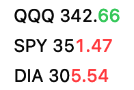
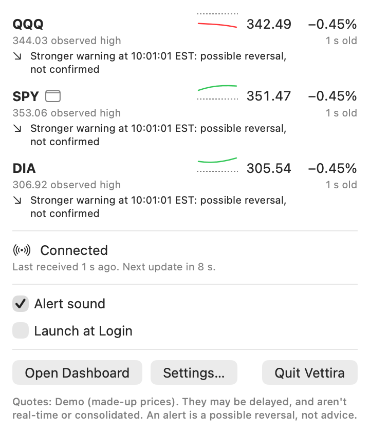
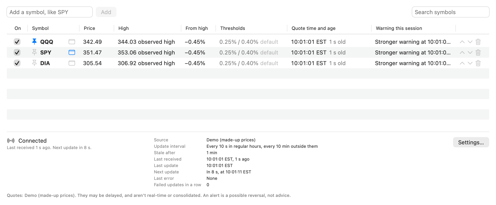
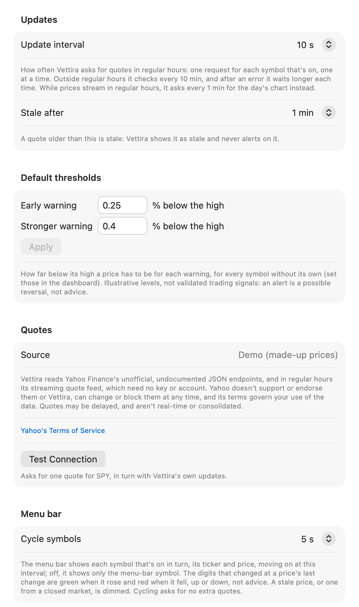

<p align="center">
  <picture>
    <source media="(prefers-color-scheme: dark)" srcset="docs/assets/logo-dark.svg">
    
  </picture>
</p>

<p align="center">
  A macOS menu-bar app that tells you when a stock or ETF pulls back from its session high.
</p>

Vettira is free, open source and local-first. It watches your stock and ETF watchlist from the
menu bar and notifies you when a price falls from its session high by a threshold you set.

> **Status: in progress.** The logic (quotes, market sessions, session highs, alerts and
> settings), the menu bar, notifications, the dashboard with watchlist editing, and Settings are
> built. [Install a release](#install), or [build it](#build-and-run) with Xcode.

<p align="center">
  
</p>

<p align="center">
  
</p>

<p align="center">
  
</p>

<p align="center">
  
</p>

<p align="center"><sub>The menu-bar item as it takes turns through three symbols, its popover, the dashboard and
Settings, from a demo run: the prices are made up (their source reads "Demo (made-up prices)"),
not Yahoo Finance's, and the times are New York's, the exchange's (EST).</sub></p>

## What it's for, and what it isn't

- **Watching your watchlist** of stocks and ETFs, each with its own thresholds, from the menu bar,
  whether or not its dashboard window is open.
- **Noticing a pullback**: it notifies you when a price falls from its session high by your early
  or stronger threshold (0.25% and 0.40% to start). Each fires once, until the high rises at least
  0.10% above the one it alerted on or a new session starts.
- **Not advice.** An alert is a possible, unconfirmed reversal, never a sell signal or an
  instruction. The thresholds are illustrative, not validated signals. What you do with an alert
  is your own decision.
- **Not a trading app.** It has no brokerage connection, needs no trading account, and places no
  orders.
- **Not real-time.** Quotes come at an interval, or in regular hours as Yahoo's feed pushes them
  (at most once a second), and may be delayed. Each shows its age, and a stale or delayed quote
  never fires an alert.

## How it works

Vettira asks for each enabled symbol's latest quote, one request at a time, and in regular hours
keeps one streaming connection open, so prices update as they change between those requests. It
tracks each
symbol's high for the US regular session (09:30 to 16:00 New York time, with holidays and early
closes), and fires an alert when the drop from that high crosses a threshold. When the data
doesn't include the session's high, Vettira uses the highest price it has seen, in its quotes and
the day's 5-minute bars, and labels it the "observed high". Alerts only fire on fresh quotes in regular hours.

More: [how alerts fire](docs/alerts.md) and [the architecture](docs/architecture.md).

## Where the data comes from

Quotes come from Yahoo Finance's **unofficial, undocumented** JSON endpoints and, in regular hours,
its **unofficial, undocumented** streaming quote feed: the ones its own web pages use. Vettira needs
no key and no account for them, and there's nothing to set up. Read this before you use it:

- **Unofficial.** Yahoo has no public market-data API. It doesn't publish, document, support,
  license or endorse these endpoints or the feed, or Vettira's use of them. Vettira isn't affiliated with
  Yahoo, and nothing here gives you any right to Yahoo's data.
- **Yahoo's terms govern your use.** Yahoo's
  [Terms of Service](https://legal.yahoo.com/us/en/yahoo/terms/otos/index.html) apply to the data
  and to how it's reached. Among other things, they restrict collecting data from Yahoo's services
  by automated means, using the services commercially, and high-volume use, each without Yahoo's
  permission, and Vettira has no permission from Yahoo. Read the terms yourself: whether your use
  follows them is between you and Yahoo, and you're responsible for it. Vettira is for personal,
  non-commercial use on your own Mac; it shows the data only to you, and you shouldn't
  redistribute or republish it.
- **It can break or be blocked without notice.** Yahoo can change the endpoints or the feed,
  rate-limit them,
  or refuse requests from apps like Vettira, from your network or from your region, at any time.
  When it does, Vettira says so, and has no quotes and fires no alerts until they work again.
- **Delayed, not consolidated, not tick-by-tick.** A quote may lag the exchange, and neither the
  endpoints nor the feed says by how much, so Vettira shows each quote's own time and age. It's
  Yahoo's view of the market, not the consolidated tape across every exchange, and Vettira sees
  the latest price each time it asks, or at most once a second from the feed, not every trade.
  Never rely on it as real-time data.

Vettira is a light client: one request per enabled symbol per update, never in parallel, at most
one a second, and in regular hours one streaming connection for the whole watchlist; while it's
live, updates slow to once a minute. It sends a User-Agent that names Vettira (never a browser's),
and backs off when Yahoo rate-limits it, errs or drops the connection. It reads no web pages and
downloads no history. **Test Connection**, in Settings, asks for one quote and says plainly what
came back or what went wrong. The requests, the fields Vettira reads and each error it can show:
[docs/providers.md](docs/providers.md).

## Install

Each release is on the [Releases page](https://github.com/nikpietanze/vettira/releases) as
`Vettira-<version>.zip`, with its SHA-256 in `Vettira-<version>.zip.sha256`. It needs **macOS 14
(Sonoma) or later**. If there's no release yet, [build it](#build-and-run) instead.

1. Download both files, and check the zip in the folder you saved them to:
   `shasum -a 256 -c Vettira-<version>.zip.sha256` should say `OK`.
2. Open the zip, and drag **Vettira** into your **Applications** folder.
3. Open it the first time. The app is signed ad hoc, not with an Apple Developer ID, and isn't
   notarized (that needs a paid Apple Developer account, which the project doesn't have yet), so
   macOS won't open it with a double-click at first:
   - **macOS 14:** Control-click (or right-click) Vettira in Applications, choose **Open**, then
     **Open** again.
   - **macOS 15 or later:** double-click it and close the warning, then open **System Settings →
     Privacy & Security**, scroll to Security, click **Open Anyway** beside Vettira, and confirm.

   After that it opens like any other app. It's in the menu bar, near the clock, with no Dock
   icon, and its watchlist starts empty: click it, pick **Open Dashboard**, and add a symbol by its
   ticker (SPY, say). More in [Using it](#using-it).

To update, quit Vettira (**Quit Vettira** in its popover), replace it in Applications with the
new one, and open it the same way. Your watchlist and settings stay where they are.

## Build and run

To build Vettira yourself, you need:

- **macOS 14 (Sonoma) or later** to run it.
- **Xcode 16 or later** to build it (the package needs Swift 6.0), from the App Store or
  [Apple's developer site](https://developer.apple.com/xcode/). Xcode 16 itself needs macOS 14.5
  or later. Open Xcode once after installing it so it finishes setting up, and if `xcodebuild`
  or `swift` complain that they need Xcode rather than the Command Line Tools, point them at it:
  `sudo xcode-select -s /Applications/Xcode.app`.
- **[XcodeGen](https://github.com/yonaskolb/XcodeGen)**, which writes the app's Xcode project from
  `App/project.yml` (the project isn't committed). With [Homebrew](https://brew.sh):
  `brew install xcodegen`.

No Apple developer account is needed: the app is signed to run on your own Mac.

**1. Get the code and generate the project:**

```sh
git clone https://github.com/nikpietanze/vettira.git
cd vettira
(cd App && xcodegen generate)
```

**2. Build and run it,** either way:

- **In Xcode:** `open App/Vettira.xcodeproj`, pick the **Vettira** scheme and **My Mac**, and
  press Run (Cmd-R).
- **From the terminal:**

  ```sh
  xcodebuild build -project App/Vettira.xcodeproj -scheme Vettira -configuration Debug \
    -destination "platform=macOS,arch=$(uname -m)" -derivedDataPath .build/xcode
  open .build/xcode/Build/Products/Debug/Vettira.app
  ```

**3. Set it up.** Vettira has no Dock icon: it shows in the menu bar, near the clock. The
watchlist starts empty, so click its menu-bar item, pick **Open Dashboard**, and add a symbol by
its ticker (SPY, say). macOS asks once whether Vettira may send notifications; allow them to get
alerts. Alerts only fire in US regular trading hours; outside them Vettira checks every 10
minutes, and the menu bar shows the last session's price, marked closed.

Run `git pull` and step 1's `xcodegen generate` again after updating, since a change can add files
to the project.

### Try it with made-up prices

A Debug build (like the ones above) can run on made-up prices instead of Yahoo's, at any time of
day, with a settings file of its own, so it leaves your watchlist alone. Quit the copy you started
above first (**Quit Vettira** in its popover): `open` passes these arguments only when it starts
the app, and otherwise just brings the running one forward:

```sh
mkdir -p /tmp/vettira-demo
echo '{"watchlist": {"entries": [{"symbol": "SPY"}, {"symbol": "QQQ"}]}, "updateInterval": 10}' \
  > /tmp/vettira-demo/settings.json
open .build/xcode/Build/Products/Debug/Vettira.app --args --demo --settings-dir /tmp/vettira-demo
```

`--demo` makes up prices that, at this 10-second update interval, warn early and then stronger
about a minute after launch. `--settings-dir` reads and writes `settings.json` in that folder
instead of your own. With either, alerts go only to the app's log, not to Notification Center,
unless you add `--notify`. In Xcode, add the same arguments under Product, Scheme, Edit Scheme…,
Run, Arguments. `--snapshot <folder>` makes a demo run that, once the warnings have come (or
after `--snapshot-after <seconds>`), saves pictures of the menu-bar item, the popover, the
dashboard and Settings, in light and dark, to that folder, offscreen, and quits. A Release build
ignores them. More: [the demo provider](docs/providers.md#the-demo-provider).

### Run the tests

```sh
swift test
```

From the repo's root, they test the logic (quotes, sessions, alerts, the monitor, what the app
shows, storage) on recorded and mock quotes, and never call Yahoo.

## Using it

The menu bar is a ticker: a symbol and its price (`SPY 741.12`), taking turns through the symbols
you monitor every 5 seconds (3 or 10, or off to show just one, in Settings). When a price changes,
the digits from the first one that changed are green if it rose and red if it fell (up or down,
not advice), and stay so until its next change; a stale price, or one from a closed market, is
dimmed. Its tooltip says the price, its change from the high, how old it is and which way it last
moved. Taking turns only shows prices Vettira already has: it makes no extra requests. Click it for
every symbol's chart of the day, price, high, pullback and data age, the connection's health, and checkboxes for the
alert sound and Launch at Login. A pullback past a threshold sends
a notification, worded as a possible reversal, never advice. Closing a window leaves Vettira
running in the menu bar, still monitoring, until you pick **Quit Vettira**.

**Open Dashboard**, in that popover, opens a window with the whole watchlist in a table: each
symbol's price, high (session or observed), change from the high, thresholds, quote time, data age
and last warning, then the connection's health and diagnostics. Add a symbol by its ticker, search
the list, drag rows or use the arrows to reorder it, pin symbols to the top, turn one off to stop
updating it, give one its own thresholds, or pick the one the menu bar shows. **Settings…** (in the
popover and the dashboard, or Cmd-, while a window is open) sets the update interval, how old a
quote can be before it's stale, the default thresholds, how often the menu bar takes turns, the
alert sound and Launch at Login, and has **Test Connection**. Each
change is saved as you make it. While one of its windows is open Vettira shows in the Dock and the
app switcher; closing the last one takes it back to the menu bar only.

## Privacy

No account, no server of its own and no telemetry. Your watchlist and settings stay on your Mac,
and the only requests Vettira makes are for quotes. The details: [PRIVACY.md](PRIVACY.md).

## Contributing

Bug reports, ideas and pull requests are welcome: [CONTRIBUTING.md](https://github.com/nikpietanze/vettira/blob/main/CONTRIBUTING.md).

## License

[MIT](LICENSE). Vettira is provided as is, without warranty of any kind, as the license says. Yahoo
and Yahoo Finance are Yahoo's trademarks, named here only to say where the data comes from.
