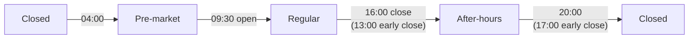
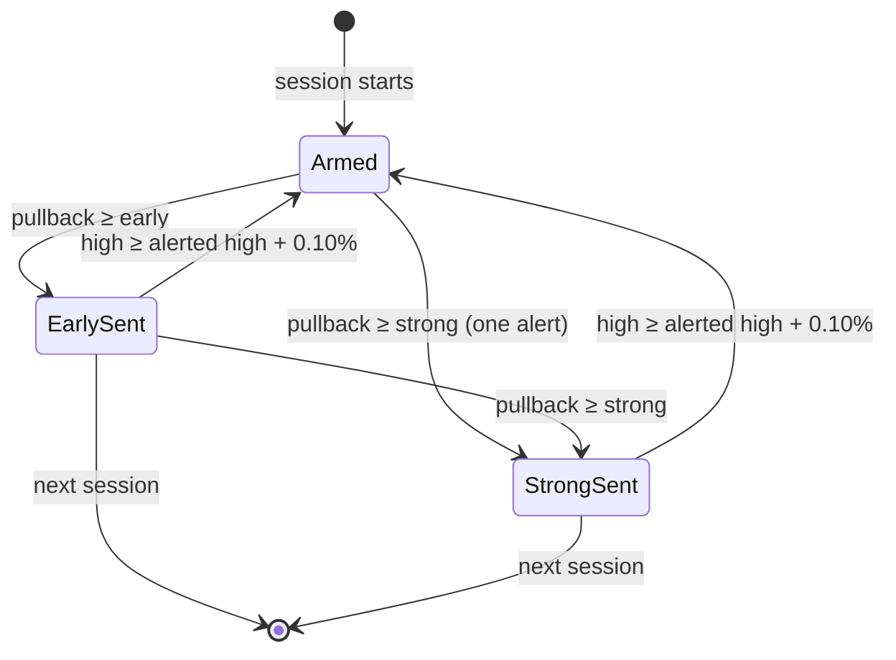

# Alerts

**Code:** `Sources/VettiraCore/Session/`, `Sources/VettiraCore/Alerts/`.

Vettira notifies you when a price pulls back from its session high by a threshold you set. An
alert is a possible, unconfirmed reversal: never advice, a sell signal or an instruction, and its
thresholds are illustrative, not validated signals. This page explains when alerts can fire.

## The market session

Alerts only fire in US regular trading hours, and each trading day starts a new session, so
highs and alert cycles reset with it. `MarketCalendar` (`Session/MarketCalendar.swift`) says,
for any instant, where it falls in the trading day, which trading day's session it belongs to,
and that session's open and close. It uses New York time (`America/New_York`) whatever the Mac's
own time zone, so it follows daylight saving time the way the exchange does, and it needs no
network.

| State | New York time | Alerts |
|---|---|---|
| Pre-market | 04:00 to 09:30 | Never |
| Regular | 09:30 to 16:00, or to 13:00 on an early-close day | Only here |
| After-hours | The close to 20:00, or to 17:00 on an early-close day | Never |
| Closed | 20:00 to 04:00, weekends and full holidays | Never |



The regular session is NYSE's core trading session. The pre-market and after-hours times are
NYSE Arca's early and late trading sessions; other venues open their extended hours later, but no
extended-hours quote ever fires an alert, so the exact edges only change how the app labels it.

**Which session an instant belongs to.** A trading day's session runs from its 04:00 pre-market
until 04:00 on the next trading day. So an evening, a weekend or a full holiday belongs to the last
trading day before it, whose high stands until the next session starts, and Monday's session
starts at 04:00 on Monday. Each session has its own open, close and after-hours close as exact
instants.

## The high

Each symbol's pullback is measured from a high that starts over with each trading day's session.
`SessionHighTracker` (`Session/SessionHighTracker.swift`) keeps it, and says which kind it is:

| Kind | What it is | Shown as |
|---|---|---|
| Session high | The regular session's high, as the provider supplied it (Yahoo's `regularMarketDayHigh`) | "session high" |
| Observed high | The highest regular-session price Vettira saw itself since it started watching the session | "observed high" |

The provider's high is used whenever it has one and no price Vettira saw is above it. When the
provider supplies none, or a price comes in above it (its high can lag the price), the high is the
observed one, and it's labelled that way: it can be lower than the day's actual high, so it's
never called the session high.

The pullback is how far the price is below the high, in percent:

```
pullbackPct = (high - price) / high * 100
```

## Thresholds and the alert cycle

Each symbol has two thresholds (`PullbackThresholds`), set for it or taken from the global
defaults: an **early warning**, by default a pullback of 0.25%, and a **stronger warning**, by
default 0.40%. They're illustrative, not validated trading signals. `ReversalAlertEngine`
(`Alerts/ReversalAlertEngine.swift`) takes each quote as it comes and fires as soon as a fresh
quote is past a threshold, with no waiting for confirmation.

An alert says it's a **possible reversal, not confirmed**, never advice or an instruction to sell.
It carries the symbol, the price, the high and whether it's the session or the observed high, the
pullback, which warning it is and the threshold it was set to, the quote's own time, the data age
(how old the quote was when it was evaluated), and its source. Its one-line summary shows the
threshold and the data age: "Early warning (0.25% threshold): possible reversal, not confirmed.
SPY is 0.30% below its observed high. Quote 5 s old."

Each threshold fires **once per high-water-mark cycle**:

- **Once.** After the early warning, a deeper pullback sends the stronger one; nothing repeats
  while the price moves around below the same high, recovering or dipping again. A quote past both
  thresholds at once sends one alert, the stronger warning, which covers the early one.
- **Rearming.** A new cycle starts, and both thresholds can fire again, when the high rises
  **0.10%** or more above the high at the last alert (`rearmPercent`), or a new trading day's
  session starts. A smaller new high moves the high, so later pullbacks are measured from it, but
  doesn't rearm.
- **Cooldown.** The same threshold doesn't fire twice for a symbol within **5 minutes**, by quote
  time (`cooldown`), even after a rearm, so a price see-sawing around a new high doesn't send a
  stream of alerts. A threshold held back fires on the first fresh quote after the cooldown that's
  still past it. The cooldown never holds the stronger warning back after an early one.
- **Already past.** If the price is past a threshold on the first quote Vettira uses in a
  session (it started mid-day, below the provider's session high), that quote alerts.



A threshold that comes up again after a rearm still waits out its cooldown.

## What keeps a quote from alerting

A quote that fails any of these checks is rejected with its reason (`QuoteRejection`): it changes
no high, fires no alert and leaves the cycle as it was.

| Reason | When |
|---|---|
| `invalidPrice` | The price isn't a positive number |
| `notInCalendar` | The calendar doesn't cover the quote's date ([below](#the-calendar)) |
| `outsideRegularHours` | The quote's time isn't in the regular session by the calendar (pre-market, after-hours, closed, or after an early close), or the provider says it isn't a regular-session quote. The close itself counts as after the session |
| `delayed` | The provider says its data is delayed by more than the staleness tolerance |
| `stale` | The quote is more than **60 seconds** old (`staleTolerance`): the time since its own timestamp, which is how a delay from a provider that doesn't declare one, like Yahoo's, shows |
| `aheadOfClock` | The quote's time is more than the staleness tolerance ahead of the Mac's clock |
| `duplicate` | The quote has the same time as the last one used |
| `outOfOrder` | The quote is older than the last one used |
| `implausibleJump` | The price moved more than **10%** (`spikePercent`) from the last price used this session. If the next quote, with a later time, is within 10% of the jumped price, the move is taken as real and that quote is used; until then nothing alerts on it |

A quote's time is the time of its last trade, not when the provider sent it. So a thinly traded
symbol that goes more than 60 seconds without a trade reads as stale, and fires no alert, even
when nothing is wrong with the data. Raise the staleness tolerance (**Stale after**, in Settings)
for a watchlist like that, knowing a higher tolerance also lets older quotes alert.

The rearm margin, the cooldown, the staleness tolerance and the spike limit are
`AlertSettings`, the same for every symbol; each has the default above, and a value out of range
(a negative cooldown, a tolerance of 0) is rejected where it comes in. Only the staleness
tolerance is the user's: Settings offers 30 seconds to an hour, and it's saved with the settings.
Each symbol's thresholds are its own or the defaults, both set in the app (the dashboard and
Settings).

## Saved state

The engine's `state` (each symbol's high, its last quote's time and price, and its cycle: which
thresholds fired, at what high and when) is `Codable`. The app saves it in `alert-state.json`, next
to the settings, after each poll that changed it, and hands it back to the engine at launch, so a
pullback that already alerted doesn't alert again after a relaunch, and the cooldown still holds.

Saved state never carries one session's cycle into the next: the first quote of a new trading
day starts a new high and a new cycle, as it does without a relaunch. A symbol taken off the
watchlist is forgotten (`removeSymbols(notIn:)`); a disabled one is kept, so turning it back on
the same day doesn't alert again. A missing file, or one that can't be read or is another
version, starts every symbol afresh, as a first launch does.

## The calendar

The calendar is a dated table of NYSE's full holidays and early closes, from NYSE's [Holidays &
Trading Hours](https://www.nyse.com/markets/hours-calendars) page (read November 9, 2026). It
covers 2026 to 2028:

| | 2026 | 2027 | 2028 |
|---|---|---|---|
| New Year's Day | Thursday, January 1 | Friday, January 1 | None (Saturday, January 1, isn't observed) |
| Martin Luther King, Jr. Day | Monday, January 19 | Monday, January 18 | Monday, January 17 |
| Washington's Birthday | Monday, February 16 | Monday, February 15 | Monday, February 21 |
| Good Friday | Friday, April 3 | Friday, March 26 | Friday, April 14 |
| Memorial Day | Monday, May 25 | Monday, May 31 | Monday, May 29 |
| Juneteenth National Independence Day | Friday, June 19 | Friday, June 18 (observed) | Monday, June 19 |
| Independence Day | Friday, July 3 (observed) | Monday, July 5 (observed) | Tuesday, July 4 |
| Labor Day | Monday, September 7 | Monday, September 6 | Monday, September 4 |
| Thanksgiving Day | Thursday, November 26 | Thursday, November 25 | Thursday, November 23 |
| Christmas Day | Friday, December 25 | Friday, December 24 (observed) | Monday, December 25 |
| **Early close, 13:00** | Friday, November 27; Thursday, December 24 | Friday, November 26 | Monday, July 3; Friday, November 24 |

Every other weekday is a full trading day. Outside the years it holds, the calendar doesn't
guess: for an instant whose session it can't place (a weekday in another year, or the hours that
belong to a trading day in another year), it says so (`status(at:)` returns `nil`), and the app
must treat that as no session, so no alert fires. A weekend is always closed, so the last
weekend of 2028 still belongs to Friday, December 29, 2028, and Monday, January 1, 2029 has no
session until 2029 is added.

### Adding a year

When NYSE publishes a year's holidays, add it to `MarketCalendar.usEquities` in
`Sources/VettiraCore/Session/MarketCalendar.swift`:

1. Add the year's entry with its full holidays and its early closes, as NYSE lists them: the
   observed date when a holiday falls on a weekend, and no entry when NYSE observes none (like
   New Year's Day 2028).
2. Add the year to this page's table, and update the date it was read.
3. Add the year's holidays and early closes to the tests in
   `Tests/VettiraCoreTests/Session/MarketCalendarTests.swift`, from NYSE's page, not from the
   table, and update the covered years test.

The table rejects a holiday or early close on a weekend, or a day that is both. Add only dates
NYSE has published; an unscheduled closure (a national day of mourning, say) is added when NYSE
announces it.
