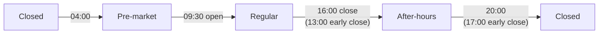

# Alerts

**Code:** `Sources/VettiraCore/Session/`, `Sources/VettiraCore/Alerts/`.

Vettira notifies you when a price pulls back from its session high by a threshold you set. An
alert is a possible, unconfirmed reversal: never advice, a sell signal or an instruction, and its
thresholds are illustrative, not validated signals. This page explains when alerts can fire.

## The market session

Alerts only fire in US regular trading hours, and each trading day starts a new session, so
highs and alert cycles reset with it. `MarketCalendar` (`Session/MarketCalendar.swift`) says,
for any instant, where it falls in the trading day, which trading day's session it belongs to,
and that session's open and close. It uses New York time (`America/New_York`) whatever the Mac's
own time zone, so it follows daylight saving time the way the exchange does, and it needs no
network.

| State | New York time | Alerts |
|---|---|---|
| Pre-market | 04:00 to 09:30 | Never |
| Regular | 09:30 to 16:00, or to 13:00 on an early-close day | Only here |
| After-hours | The close to 20:00, or to 17:00 on an early-close day | Never |
| Closed | 20:00 to 04:00, weekends and full holidays | Never |

The regular session is NYSE's core trading session. The pre-market and after-hours times are
NYSE Arca's early and late trading sessions; other venues open their extended hours later, but no
extended-hours quote ever fires an alert, so the exact edges only change how the app labels it.

**Which session an instant belongs to.** A trading day's session runs from its 04:00 pre-market
until 04:00 on the next trading day. So an evening, a weekend or a full holiday belongs to the last
trading day before it, whose high stands until the next session starts, and Monday's session
starts at 04:00 on Monday. Each session has its own open, close and after-hours close as exact
instants.

## The calendar

The calendar is a dated table of NYSE's full holidays and early closes, from NYSE's [Holidays &
Trading Hours](https://www.nyse.com/markets/hours-calendars) page (read November 9, 2026). It
covers 2026 to 2028:

| | 2026 | 2027 | 2028 |
|---|---|---|---|
| New Year's Day | Thursday, January 1 | Friday, January 1 | None (Saturday, January 1, isn't observed) |
| Martin Luther King, Jr. Day | Monday, January 19 | Monday, January 18 | Monday, January 17 |
| Washington's Birthday | Monday, February 16 | Monday, February 15 | Monday, February 21 |
| Good Friday | Friday, April 3 | Friday, March 26 | Friday, April 14 |
| Memorial Day | Monday, May 25 | Monday, May 31 | Monday, May 29 |
| Juneteenth National Independence Day | Friday, June 19 | Friday, June 18 (observed) | Monday, June 19 |
| Independence Day | Friday, July 3 (observed) | Monday, July 5 (observed) | Tuesday, July 4 |
| Labor Day | Monday, September 7 | Monday, September 6 | Monday, September 4 |
| Thanksgiving Day | Thursday, November 26 | Thursday, November 25 | Thursday, November 23 |
| Christmas Day | Friday, December 25 | Friday, December 24 (observed) | Monday, December 25 |
| **Early close, 13:00** | Friday, November 27; Thursday, December 24 | Friday, November 26 | Monday, July 3; Friday, November 24 |

Every other weekday is a full trading day. Outside the years it holds, the calendar doesn't
guess: for an instant whose session it can't place (a weekday in another year, or the hours that
belong to a trading day in another year), it says so (`status(at:)` returns `nil`), and the app
must treat that as no session, so no alert fires. A weekend is always closed, so the last
weekend of 2028 still belongs to Friday, December 29, 2028, and Monday, January 1, 2029 has no
session until 2029 is added.

### Adding a year

When NYSE publishes a year's holidays, add it to `MarketCalendar.usEquities` in
`Sources/VettiraCore/Session/MarketCalendar.swift`:

1. Add the year's entry with its full holidays and its early closes, as NYSE lists them: the
   observed date when a holiday falls on a weekend, and no entry when NYSE observes none (like
   New Year's Day 2028).
2. Add the year to this page's table, and update the date it was read.
3. Add the year's holidays and early closes to the tests in
   `Tests/VettiraCoreTests/Session/MarketCalendarTests.swift`, from NYSE's page, not from the
   table, and update the covered years test.

The table rejects a holiday or early close on a weekend, or a day that is both. Add only dates
NYSE has published; an unscheduled closure (a national day of mourning, say) is added when NYSE
announces it.
