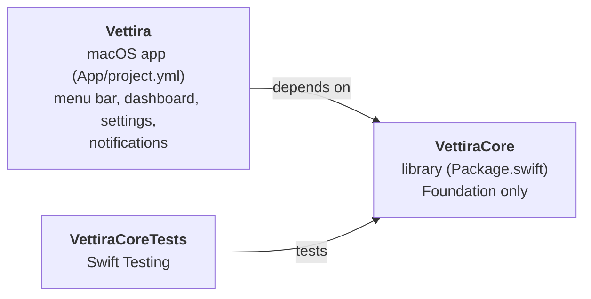
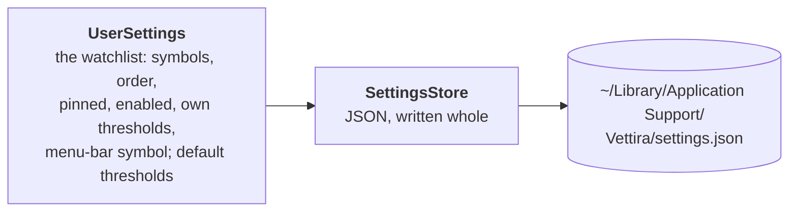
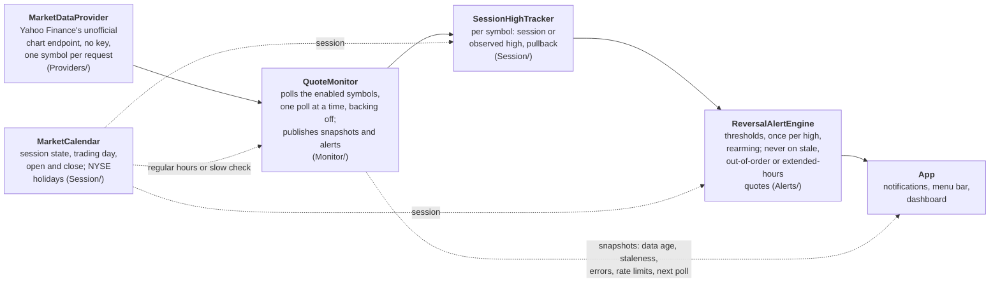
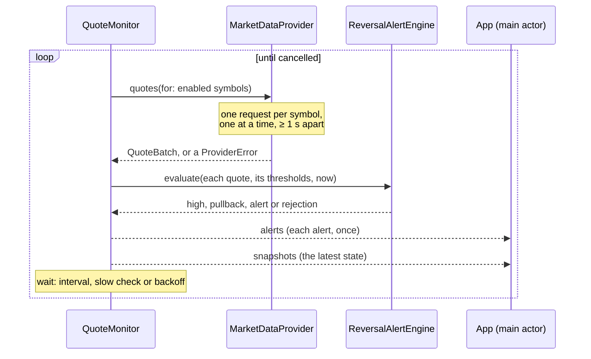

# Architecture

**Code:** `Package.swift`, `Sources/VettiraCore/`, `App/`.

Vettira is a Swift package, `VettiraCore`, holding the app's logic, and a macOS app, `Vettira`,
that shows it in the menu bar and a dashboard window. The logic uses Foundation only, so its tests
run with `swift test` and need no UI and no network: they use recorded and mock quotes.

## Targets

| Target | Where | What it is |
|---|---|---|
| `VettiraCore` | `Sources/VettiraCore/` | The logic: quotes and the market-data provider protocol (`Providers/`), the market session and session-high tracking (`Session/`), the reversal alert engine (`Alerts/`), the quote monitor that polls and publishes (`Monitor/`), local storage (`Storage/`) |
| `VettiraCoreTests` | `Tests/VettiraCoreTests/` | Its tests, on recorded and mock quotes |
| `Vettira` | `App/Vettira/` | The app, from `App/project.yml` with [XcodeGen](https://github.com/yonaskolb/XcodeGen): a `MenuBarExtra` and a dashboard `Window`. Bundle ID `com.andiamosoftware.vettira`, macOS 14 and later, menu bar only (`LSUIElement`), so it has no Dock icon |

The Xcode project is generated, never committed: `cd App && xcodegen`, then open
`App/Vettira.xcodeproj`.

## The app

The menu-bar item is the app: it runs until the user picks **Quit** from its menu. The dashboard is
a separate `Window` scene the menu opens (**Open Dashboard**); closing it leaves the menu-bar item,
and monitoring, running. Monitoring will belong to the app's shared state, not to the dashboard's
views, so it doesn't stop or restart when the window closes or opens.

So far the app is the shell: a menu with Open Dashboard and Quit, and an empty dashboard.

## Storage

What the user sets up stays on their Mac, in one file, as [PRIVACY.md](../PRIVACY.md) promises.

`UserSettings` (`Sources/VettiraCore/Storage/`) holds the `Watchlist` and the default
`PullbackThresholds`; `SettingsStore` saves it as JSON in
`~/Library/Application Support/Vettira/settings.json`, replacing the file whole on each save.
Input is checked where it comes in, into types that can't hold a bad value: a `TickerSymbol` is
trimmed, uppercased, 1 to 15 of `A-Z 0-9 . - ^ =`; thresholds are each between 0 and 100
percent, early below strong; the watchlist has each symbol once, and its menu-bar symbol is on
it. Decoding goes through the same checks, so a file that breaks them is corrupt: the store moves
it to `settings.corrupt.json` and starts from the defaults (an empty watchlist, 0.25% and
0.40%). A field an older file lacks gets its default, so a new setting is added with
`decodeIfPresent` and a default.

## The pipeline

How a quote becomes an alert. Each box is a part of `VettiraCore` except the last, which is the
app.

The provider reads Yahoo Finance's unofficial, undocumented JSON chart endpoint
(`v8/finance/chart`), which takes one symbol per request: each poll sends one request per enabled
symbol, one at a time and at most one a second, backing off when Yahoo rate-limits or errors.
Yahoo doesn't support or endorse it, it can change or be blocked without notice, and Yahoo's
terms govern its use; [spec.md](spec.md) says what that data is and isn't. The `MarketDataProvider`
protocol keeps the rest of the pipeline independent of it, so a licensed or streaming provider
can be added later. The protocol, the normalized quote, the provider's requests and its errors
are in [providers.md](providers.md).

The market calendar is built: for any instant it gives the US regular session's state, the
trading day it belongs to and that session's open and close, from NYSE's published holidays and
early closes. So are the session-high tracker and the alert engine: per symbol, the engine
rejects a quote that isn't fresh, in order and in regular hours, keeps the session or observed
high, and fires each threshold once per high-water-mark cycle, with a `Codable` state the app can
save. [alerts.md](alerts.md) describes the session rules, the years the calendar covers, and when
alerts fire. The monitor is built too ([below](#polling)); the app's menu bar, notifications and
dashboard are still to come.

An alert is a possible, unconfirmed reversal, never advice or an instruction to sell, and its
thresholds are illustrative. The spec is [spec.md](spec.md).

## Polling

`QuoteMonitor` (`Sources/VettiraCore/Monitor/`) is an actor that polls the watchlist's enabled
symbols through the `MarketDataProvider`, runs each quote through the `ReversalAlertEngine`, and
publishes what it knows. The app starts it once, in its shared state, with `run()` in a task it
keeps for as long as the app runs, and stops it by cancelling that task; closing the dashboard
doesn't touch it.

**How often.** One poll at a time: `run()` does nothing if it's already running, and the provider
sends a poll's requests one after another, at least a second apart. The next poll waits for the
update interval (`MonitorSettings.interval`, 15 seconds by default, from 10 seconds to an hour)
from the start of the last one, so with one symbol it's one request every 15 seconds. The wait is
never shorter than the poll took, so Vettira is idle at least half the time: a 20-symbol
watchlist, which takes about 20 seconds at one request a second, waits 20 seconds after each poll
rather than polling back to back.
Outside regular hours (pre-market, after-hours, overnight, weekends, holidays, or a date the
calendar doesn't cover) it only checks every 10 minutes, or every interval when that's longer;
in the pre-market it checks no later than the open, so regular-hours polling starts on time.

**Backoff.** A poll that fails (rate limited, blocked, unreachable, unreadable) waits the update
interval doubled for each failure in a row, 30 s, 60 s, 120 s and so on with the default, up to
15 minutes (or the interval, when that's longer), and never less than the regular wait. A rate
limit's `Retry-After` is honoured, even past the cap. The first poll that succeeds goes back to the
normal interval. A symbol the provider doesn't know, or has no usable quote for, isn't a failure:
it's marked on that symbol, and the rest update.

**What it publishes.** Two `AsyncStream`s, each read by one consumer, the app's shared state on
the main actor (`for await snapshot in monitor.snapshots { … }`), so `VettiraCore` needs no
SwiftUI:

| Stream | What | Buffer |
|---|---|---|
| `snapshots` | A `MonitorSnapshot` after each poll and each settings change, starting with the state before the first poll | The latest only: a consumer that falls behind skips to it |
| `alerts` | Each `ReversalAlert` as it fires, once, for notifications | Every alert, none dropped |

A snapshot holds, for each enabled symbol (`SymbolSnapshot`): the latest quote, its data age when
the snapshot was taken, whether it's stale, the high and whether it's the session or the observed
high (only for the current trading day's session), the pullback, why the engine couldn't use the
latest quote if it couldn't, the last alert, and why the provider had no quote for it if it
didn't. Its diagnostics (`MonitorDiagnostics`) are the source, the market state, when the last
poll finished and when quotes last came back, the wait before the next poll and when it's due,
the last error with its message and next step, and how many polls in a row have failed.

**Stale data.** A symbol is stale when it has no quote yet, its quote is older than the staleness
tolerance (`AlertSettings.staleTolerance`, 60 seconds by default), or the provider says it's
delayed by more. The engine fires nothing on a stale quote ([alerts.md](alerts.md)), so price
alerts are suspended until fresh data comes, and the app shows the symbol as stale. When the
provider stops answering, each snapshot's data age keeps growing until the symbol turns stale.
Outside regular hours a symbol's latest quote is the last session's, so it turns stale once that
quote is older than the tolerance: by default, a minute after the close.

**Settings and saved state.** `update(settings:)` takes a new watchlist or thresholds: a symbol
added or enabled is listed straight away and polled from the next poll, and one removed or
disabled is dropped. `update(monitorSettings:)` and `update(alertSettings:)` take a new interval
and new alert settings. The engine's state is `engineState`, `Codable`, and `init` takes it back,
so the app can save it and a relaunch doesn't alert again for a pullback it already alerted.

Its tests (`Tests/VettiraCoreTests/Monitor/`) drive it with a fake provider and a clock that only
moves when the monitor waits, so no test waits on the wall clock or calls Yahoo.
