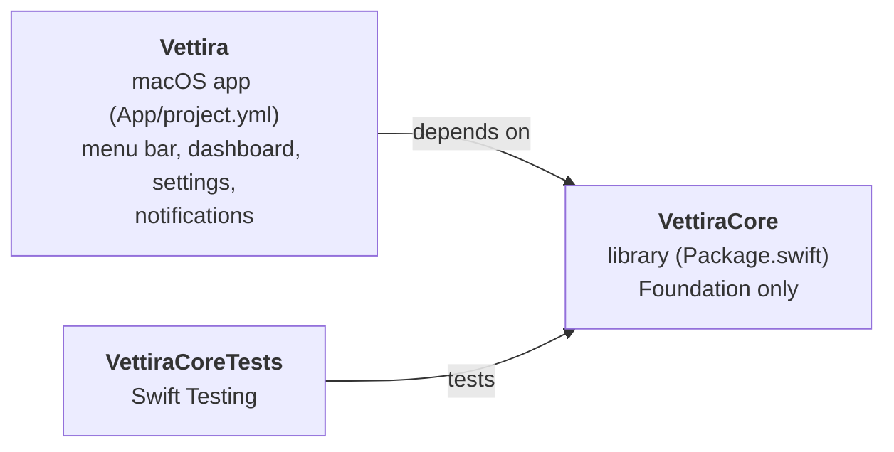
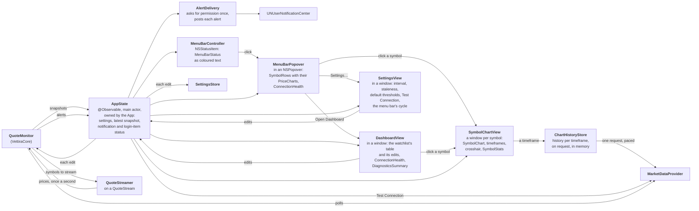
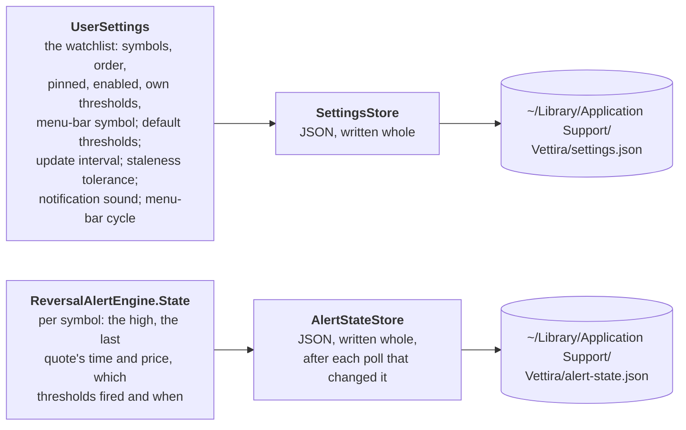
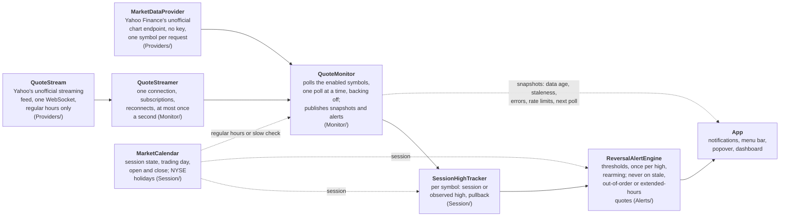
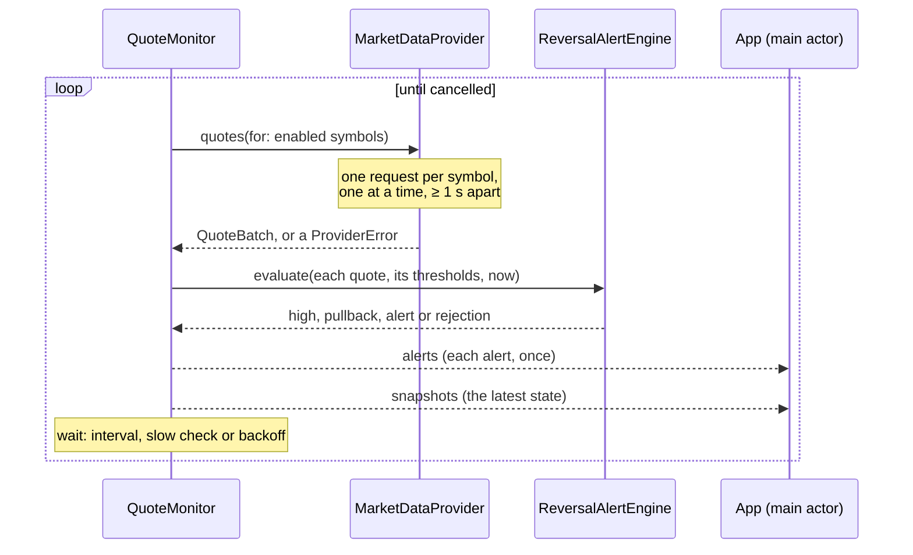
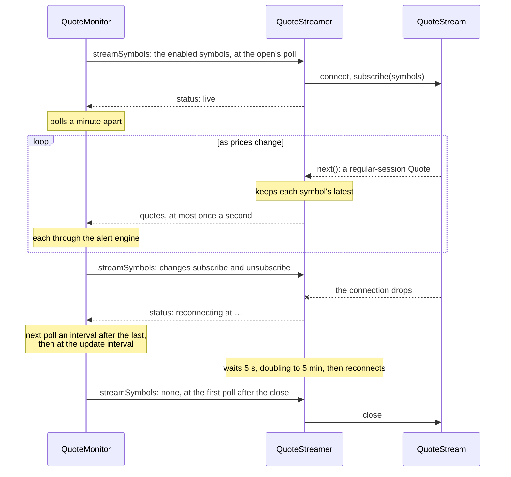

# Architecture

**Code:** `Package.swift`, `Sources/VettiraCore/`, `App/`.

Vettira is a Swift package, `VettiraCore`, holding the app's logic, and a macOS app, `Vettira`,
that shows it in the menu bar and a dashboard window. The logic uses Foundation only, so its tests
run with `swift test` and need no UI and no network: they use recorded and mock quotes.

## Targets

| Target | Where | What it is |
|---|---|---|
| `VettiraCore` | `Sources/VettiraCore/` | The logic: quotes and the market-data provider protocol (`Providers/`), the market session and session-high tracking (`Session/`), the reversal alert engine (`Alerts/`), the quote monitor that polls and publishes (`Monitor/`), what the menu bar and its popover show (`Display/`), notifications' wording and delivery (`Notifications/`), local storage (`Storage/`), a Debug run's launch arguments (`LaunchOptions`) |
| `VettiraCoreTests` | `Tests/VettiraCoreTests/` | Its tests, on recorded and mock quotes |
| `Vettira` | `App/Vettira/` | The app, from `App/project.yml` with [XcodeGen](https://github.com/yonaskolb/XcodeGen): an `NSStatusItem` with an `NSPopover`, a dashboard window and a Settings window, each hosting SwiftUI views. Bundle ID `com.andiamosoftware.vettira`, macOS 14 and later, a menu-bar app (`LSUIElement`): it shows in the Dock only while one of its windows is open. Release builds are stripped, their debug symbols in a dSYM beside the app |

The Xcode project is generated, never committed: `cd App && xcodegen`, then open
`App/Vettira.xcodeproj`.

## The app

The menu-bar item is the app: it runs until the user picks **Quit**. `MenuBarController`
(`App/Vettira/MenuBarController.swift`) puts it in the menu bar as an `NSStatusItem` whose button
toggles a transient `NSPopover`, and the popover's **Open Dashboard** opens the dashboard window
and its **Settings…** the Settings window (as do the dashboard's **Settings…** and the app menu's,
Cmd-,); each hosts SwiftUI views (`NSHostingController`). Closing the popover or a window leaves
the menu-bar item, and monitoring, running.

**The Dock.** Vettira is a menu-bar app, so it has no Dock icon, except while one of its windows
is open: then it shows in the Dock and the app switcher (`NSApp.setActivationPolicy(.regular)`),
so the window can be found like any app's, and has its app menu. When the last one closes it
goes back to the menu bar only (`.accessory`); a minimized window still counts as open.
`DockPresence` (`VettiraCore`, `Display/`) keeps which windows are open and says when that
changes, and `MenuBarController`, each window's delegate, applies it.

Why AppKit rather than SwiftUI's `MenuBarExtra`: a window-style `MenuBarExtra` (the kind that
shows a popover rather than a menu) opens only on a real mouse event, so neither accessibility
(VoiceOver, UI scripts) nor the app itself can open it. The status item's button action is the
one a click, an accessibility press and VoiceOver all take, and the button's accessibility is the
app's to set.

**The app's state.** `AppState` (`App/Vettira/AppState.swift`) is `@Observable`, on the main
actor, and owned by the app's delegate (`App/Vettira/VettiraApp.swift`) from launch until Quit,
not by a view. At launch it loads the settings
(`SettingsStore.applicationSupport()`), starts the `QuoteMonitor` on Yahoo Finance's provider
and a `QuoteStreamer` on Yahoo's streaming feed (`streamer.run(for: monitor)`; a demo run has no
streamer), and reads both of the monitor's streams for as long as the app runs: each snapshot replaces the last, and
each alert goes to `AlertDelivery`. The menu bar (which redraws as the state it reads changes),
the popover, the dashboard and Settings read it, and change the settings only through its
methods, so opening or closing a window changes nothing, and reopening one shows the same state.
It also moves its own clock every 5 seconds, so the menu bar turns stale on time between polls,
and the popover and dashboard redraw every second while they're open, so data ages count up.

**What it shows.** What the views show is worked out in `VettiraCore` (`Display/`), so it's
tested without a UI:

| Type | What it is |
|---|---|
| `MenuBarStatus` | The menu bar for one symbol: its ticker and price only (`SPY 741.12`), as segments each with a tone: the characters its last `PriceChange` changed `up` or `down`, the rest `normal`. A price outside regular hours, or older than the staleness tolerance (even between polls), is `dimmed` (the label colour at 75% of its opacity, never green or red) whatever its last change, and so is a sign there's no price (`SPY …` waiting, `SPY —` no quote, `SPY off`). Its detail says it all in words: the change from the high and its age, or why it's stale or closed, and "possible reversal, not confirmed" while a warning that fired this session is still passed; its accessibility value is the detail and then the last change ("Last change: up from 740.43.") when its colours show |
| `PriceChange`, `PriceChanges` | Which characters of a price changed and which way: the old and new prices compared as displayed, from the left, everything from the first difference to the end changed (all of it when the number of characters changes). `PriceChanges` keeps each symbol's latest price and last change from every snapshot, so each symbol keeps its colours until its own next change, whichever symbol is showing |
| `MenuBarCycle` | Which symbol the menu bar shows: the enabled symbols in the watchlist's order, starting at the menu-bar symbol, moving on every `menuBarCycle` seconds (off, 3, 5 or 10; 5 by default), or with it off only the menu-bar symbol. It only rotates what the monitor already has: no requests |
| `PriceChart` | A small chart of a symbol's day, from its quote's bars and latest price: the points (`x` by time from the first price to the last, `y` from the lowest price to the highest, the previous close counted so its line always shows), broken where a bar has no price; the previous close's level; the direction, up, down, flat (0.00%) or unknown (no previous close); and the chart in words, "Chart of today's price for SPY, updated with each quote: up 0.42% from the previous close of 510.10." (the last session's, on a later day). `lines(width:height:inset:)` scales it into the image the app draws |
| `SymbolChart` | The chart window's maths for one timeframe's `PriceHistory`: each price's place across (1D by time over the session, longer timeframes one bar after another, leaving out nights and weekends) and its unbroken run, the price range with room above and below, the change over the period from the close before it (`+2.22 (+0.30%) today`, `−37.51 (−9.64%) past year`) and its direction, the period's high and low, the time labels in ET (hours, days, weeks, months or years) and `ticks(atMost:)` to thin them, the point `nearest(toX:)` the pointer, and its `readout` for the crosshair (`13:24 ET`, the price, `+0.40%`, `Vol 412K`). The line ends at the latest quote's price. 1D draws the previous close |
| `SymbolStats` | The figures under the chart, whatever the timeframe: the day's open, previous close and volume from the latest quote and its bars (Yahoo's day volume when it gives one); the day's high and low only as the provider supplies them for the regular session (`sessionHigh`, `sessionLow`), a dash otherwise, since a high Vettira worked out itself is only ever the observed high; the session or observed high, labelled as which it is, the change from it, and the thresholds |
| `SymbolRow` | A watchlist symbol in the popover and the dashboard, pinned first: price, its day's `PriceChart` (the popover and the dashboard draw it), high and whether it's the session or the observed high, change from the high, the quote's own time and its data age, why its data can't alert (off, waiting, unknown symbol, market closed, stale, unconfirmed jump), its thresholds and whether they're its own, and the last warning this session; and whether a search finds it. Clicking one in the popover, or its ticker or chart in the dashboard, opens its chart window |
| `ConnectionHealth` | Waiting, connected ("Connected, prices streaming" while the stream is live), outside regular hours, or failing with the provider error's message and next step; when data last came and when the next update is |
| `DiagnosticsSummary` | The dashboard's diagnostics, label and value: the source, the update interval in and outside regular hours (and while prices stream), the stream's state (off, connecting, live since when, or reconnecting in how long and why) when there's a stream, the staleness tolerance, when quotes last came, the last and next update, the last error and how many updates in a row have failed |
| `ConnectionTestReport` | What Settings' Test Connection found: the quote with its time, age and source; that it's stale, in regular hours; the last session's price, while the market is closed; or the provider error's message and next step. `run(on:symbol:…)` asks the provider |
| `SettingsChoices` | The update intervals (10 s to 1 h) and staleness tolerances Settings offers, the saved value always among them, and a warning when the tolerance is shorter than the interval, so quotes would turn stale between updates |
| `DockPresence` | Which windows are open, so whether Vettira shows in the Dock |

The menu-bar item's accessibility label (its description) is always "Vettira", whatever it
shows, so VoiceOver names it and UI scripts can find it, and its accessibility value is the status
in full, the last change's direction included, which changes with it; the tooltip says the same.
Its accessibility title stays the text it shows (the ticker and price): macOS reports a status
item's title from its button's text.

**The ticker.** The button shows only text, `MenuBarStatus`'s segments as an attributed title in
the menu bar's font with digits all the same width: `normal` in the label colour, `up` system
green, `down` system red, as `Tone.ink` says; `dimmed` is the label colour at 75% of its own
opacity, a little softer than a live price but easy to read, which Core decides and the app
draws. All are dynamic, so they follow a light, dark or tinted menu bar and the highlighted
button: each resolves when the button draws, in the menu bar's own appearance (a vibrant one),
not the app's. The dimmed colour scales the label colour's alpha in that appearance rather than
replacing it, since the label colour is already translucent there; the secondary label colour was
too faint to read in the menu bar. With an empty watchlist it shows the app's chart
icon, so there's still an item to click. `AppState` records each snapshot in its `PriceChanges`
and keeps the symbol shown last; a task moves it on with `MenuBarCycle.next` every `menuBarCycle`
seconds, and picking a symbol in the popover or the dashboard shows it straight away, for a
whole turn, even one that's turned off (`SPY off`); the next turn goes on from there.

**The chart.** Each popover row draws the symbol's `PriceChart`, about 40 by 16 points
(`PriceChartImage`, `App/Vettira/`), before its price. The line is system green when the price is up on the day
(above the previous close) and system red when it's down, with the previous close as a faint
dotted line; green and red say up or down on the day, never buy or sell, and the line's place
against the dotted one and the words in the accessibility value and tooltip say it without colour.
The images draw each time they're shown, with the system's dynamic colours, so they follow a light
or dark popover. It's today's price, updated with each quote: the bars
come with each polled quote and each poll replaces them, and the line ends at the latest price,
polled or streamed; the row still shows the data's age or that it's stale or closed.

**A symbol's chart.** Clicking a symbol in the popover or the dashboard (its ticker, its day's
chart, a double-click on its row, or **Open Chart** in its context menu) opens its chart window,
one per symbol (`SymbolChartView`, `App/Vettira/`), which `MenuBarController` makes the first time
and keeps when it's closed. It draws `SymbolChart` with Swift Charts: a smooth line over a fill
that fades downward, green when the period is up and red when it's down, light gridlines with
prices on the right and times along the bottom, and on 1D the previous close as a dotted line.
Hovering shows a crosshair and a tooltip with the `readout`. The timeframe pills ask
`AppState.history(for:timeframe:)`, which asks `ChartHistoryStore` (`Providers/`): 1D is the polled
quote's own bars, so it needs no request and moves with each poll; any other timeframe is the
cached history while it's fresh, or one request through the monitor's own provider, so it waits
behind any poll's request and keeps to its pace ([providers.md](providers.md#history-for-the-chart)).
Each line ends at the latest price, polled or streamed. The header always shows the quote's time
and age, or why it can't alert, so the chart never looks live when it isn't. The `SymbolStats`
grid needs no request. The dashboard's rows draw each symbol's day as a small line
(`SparklineView`) from its `PriceChart`.

**Notifications.** `AlertDelivery` (`Sources/VettiraCore/Notifications/`) posts each alert
through `UNUserNotificationCenter`, with a sound unless the user turned it off (**Alert sound**
in the popover, saved in the settings). It asks for permission at launch when a symbol is
monitored, the first moment an alert can come, or at the first alert otherwise; the system asks
the user once. When notifications are off, alerts only show in the menu bar and the popover, and
the popover says so with a button to System Settings. `AlertNotification` words it as a possible
reversal, never advice: the ticker, the price, the high and its kind, the drop from the high, the
warning and its threshold, and the quote's own time and age:

> **SPY: possible reversal, not confirmed** 
> Early warning (0.25% threshold) 
> 512.30 is 0.30% below the observed high of 513.84. Quote at 10:31:05 EST, 5 s old, from Yahoo
> Finance (unofficial).

Banners show even while Vettira's popover or dashboard is open (`NotificationPresenter`).

**The dashboard** (`DashboardView`) is the watchlist as a table, a `SymbolRow` a row, with the
controls to edit it: add a symbol (checked as a `TickerSymbol`, saying why when it isn't one, or
is already on the list), search, reorder (drag a row while the list isn't filtered, or its up and
down arrows; pinned symbols stay first), pin, switch a symbol on or off, give it its own
thresholds or put it back on the defaults, pick the menu bar's symbol, and remove it. Under the
table are the connection's health and its diagnostics.

**Settings** (`SettingsView`) has the update interval and the staleness tolerance, the default
thresholds, where quotes come from with Yahoo's terms, **Test Connection**, **Cycle symbols**
(how often the menu bar moves on: off, 3, 5 or 10 s, 5 by default), and the alert sound and Launch at Login switches. Thresholds are typed as percents and checked together
(`PullbackThresholds(early:strong:)` from text), saying why when they're refused. Test Connection
asks the monitor's own provider for one quote for the menu-bar symbol (SPY while the watchlist is
empty), so its request waits behind any of the monitor's and keeps to the same pacing; it's
user-triggered, one at a time, and in a demo run asks the demo provider.

**Every edit**, in the dashboard, Settings or the popover, goes through `AppState`: it's made on a
copy of the settings, which is saved whole straight away and handed to the monitor
(`update(settings:)`), so it applies from the next poll and survives a relaunch. An edit the
settings' types refuse changes nothing.

**Launch at Login** is a checkbox in the popover and a switch in Settings, off until the user turns it on. It registers the
app with `SMAppService.mainApp`; when macOS wants the user to approve it, the popover says so and
opens Login Items.

**Debug launch options.** A Debug build reads its launch options (`LaunchOptions`, in
`VettiraCore`), each as a launch argument or an environment variable: `--demo`
(`VETTIRA_DEMO=1`), for the demo provider's made-up prices
([providers.md](providers.md#the-demo-provider)) on a clock moved into regular hours, and
`--settings-dir <path>` (`VETTIRA_SETTINGS_DIR`), for a directory other than Application Support
to keep `settings.json` and `alert-state.json` in (`storageDirectory`), so the app can be run and
checked without calling Yahoo or touching the user's files. A demo run without one keeps no alert
state (`keepsAlertState`), so its made-up highs never reach the user's own file. Either one makes the run a check (`isCheck`), whose alerts go only to the log
(`LogNotificationCenter`, each notification's full text) and which never asks for notification
permission, unless it's also launched with `--notify` (`VETTIRA_NOTIFY=1`). A check also neither
reads nor saves its windows' frames (`remembersWindowFrames`): they live in the app's defaults,
which the user's own Vettira shares, so a check's windows open at their first size each launch.
`--snapshot <dir>` (`VETTIRA_SNAPSHOT_DIR`) makes a demo run that draws its own pictures
(`LaunchOptions.Snapshot`): it puts no item in the menu bar and no window on screen, and
`SnapshotRenderer` (`App/Vettira/SnapshotRenderer.swift`), once every symbol has had its stronger
warning (`isDue`, at most three minutes) or `--snapshot-after <seconds>`
(`VETTIRA_SNAPSHOT_AFTER`) after launch, draws the menu-bar item as it shows each symbol in its
cycle, one under another, with `MenuBarController`'s own title, then the popover, the dashboard and Settings, the real views on the app's own
state, in light and dark, into PNG files in that directory, from windows that are never put on
screen, then quits. Release builds ignore them all (`LaunchOptions.launch`, `debugBuild`).

## Storage

What the user sets up stays on their Mac, in one file, and what the alert engine remembers in
another next to it, as [PRIVACY.md](../PRIVACY.md) promises.

`UserSettings` (`Sources/VettiraCore/Storage/`) holds the `Watchlist` and the default
`PullbackThresholds`; `SettingsStore` saves it as JSON in
`~/Library/Application Support/Vettira/settings.json`, replacing the file whole on each save. It
also holds whether notifications play a sound, how often the menu bar cycles (`menuBarCycle`, in
seconds, 0 for off), the update interval (`MonitorSettings`, saved as
`updateInterval` in seconds) and the alert engine's settings, of which only the staleness
tolerance is the user's and saved (`staleTolerance`, in seconds; the rest are the standard ones).
Input is checked where it comes in, into types that can't hold a bad value: a `TickerSymbol` is
trimmed, uppercased, 1 to 15 of `A-Z 0-9 . - ^ =`; thresholds are each between 0 and 100
percent, early below strong; the watchlist has each symbol once, and its menu-bar symbol is on
it; the update interval is from 10 seconds to an hour, the menu bar's cycle off or from 1 to 60
seconds, and the staleness tolerance more than 0. Decoding goes through the same checks, so a file that breaks them is corrupt: the store moves
it to `settings.corrupt.json` and starts from the defaults (an empty watchlist, 0.25% and
0.40%, a 15-second interval and a 60-second tolerance). A field an older file lacks gets its default, so a new setting is added with
`decodeIfPresent` and a default, and one it has that's no longer used (`showChartInMenuBar`, from
before the menu bar was a ticker) is ignored.

`AlertStateStore` saves the alert engine's state as JSON in `alert-state.json`, next to the
settings, in a format with a `version` (1), replacing the file whole on each save. It's a cache of
what the engine remembers, so a relaunch doesn't alert again for a pullback it already alerted
([alerts.md](alerts.md#saved-state)): a missing file is an empty state, and one that can't be
read, isn't valid state or is another version is logged and alerts start afresh; the next save
replaces it. A change to the state's format bumps the version rather than migrating it.
`LaunchStorage` loads the settings at launch and decides where the run saves them and the alert
state: a run on the defaults because `settings.json` couldn't be used keeps no alert state, since
its empty watchlist would drop every symbol's, and leaves `alert-state.json` as it is; one whose
`settings.json` is there but couldn't be read doesn't save its settings either, so as not to
replace the file.

## The pipeline

How a quote becomes an alert. Each box is a part of `VettiraCore` except the last, which is the
app.

The provider reads Yahoo Finance's unofficial, undocumented JSON chart endpoint
(`v8/finance/chart`), which takes one symbol per request: each poll sends one request per enabled
symbol, one at a time and at most one a second, backing off when Yahoo rate-limits or errors.
Yahoo doesn't support or endorse it, it can change or be blocked without notice, and Yahoo's
terms govern its use; [spec.md](spec.md) says what that data is and isn't. The `MarketDataProvider`
protocol keeps the rest of the pipeline independent of it, so a licensed provider can be added
later. In regular hours, prices also stream in between polls from Yahoo's unofficial streaming
quote feed, through the `QuoteStream` protocol ([below](#streaming)). The protocols, the
normalized quote, the provider's requests, the feed's messages and their errors are in
[providers.md](providers.md).

The market calendar is built: for any instant it gives the US regular session's state, the
trading day it belongs to and that session's open and close, from NYSE's published holidays and
early closes. So are the session-high tracker and the alert engine: per symbol, the engine
rejects a quote that isn't fresh, in order and in regular hours, keeps the session or observed
high, and fires each threshold once per high-water-mark cycle, with a `Codable` state the app can
save. [alerts.md](alerts.md) describes the session rules, the years the calendar covers, and when
alerts fire. The monitor is built too ([below](#polling)), and so are the app's menu bar,
popover, notifications, dashboard and Settings ([above](#the-app)).

An alert is a possible, unconfirmed reversal, never advice or an instruction to sell, and its
thresholds are illustrative. The spec is [spec.md](spec.md).

## Polling

`QuoteMonitor` (`Sources/VettiraCore/Monitor/`) is an actor that polls the watchlist's enabled
symbols through the `MarketDataProvider`, runs each quote through the `ReversalAlertEngine`, and
publishes what it knows. The app starts it once, in its shared state, with `run()` in a task it
keeps for as long as the app runs, and stops it by cancelling that task; closing the dashboard
doesn't touch it.

**How often.** One poll at a time: `run()` does nothing if it's already running, and the provider
sends a poll's requests one after another, at least a second apart. The next poll waits for the
update interval (`MonitorSettings.interval`, set in Settings: 15 seconds by default, from 10
seconds to an hour) from the start of the last one, so with one symbol it's one request every 15
seconds. While prices stream, the polls in regular hours come a minute apart instead
(`MonitorSettings.streamingInterval`: a minute, or the interval when that's longer), and when the
stream drops, the next poll comes forward to an interval after the last one started
([Streaming](#streaming)). The wait is
never shorter than the poll took, so Vettira is idle at least half the time: a 20-symbol
watchlist, which takes about 20 seconds at one request a second, waits 20 seconds after each poll
rather than polling back to back.
Outside regular hours (pre-market, after-hours, overnight, weekends, holidays, or a date the
calendar doesn't cover) it only checks every 10 minutes, or every interval when that's longer;
in the pre-market it checks no later than the open, so regular-hours polling starts on time.

**Backoff.** A poll that fails (rate limited, blocked, unreachable, unreadable) waits the update
interval doubled for each failure in a row, 30 s, 60 s, 120 s and so on with the default, up to
15 minutes (or the interval, when that's longer), and never less than the regular wait. A rate
limit's `Retry-After` is honoured, even past the cap. The first poll that succeeds goes back to the
normal interval. A symbol the provider doesn't know, or has no usable quote for, isn't a failure:
it's marked on that symbol, and the rest update.

**What it publishes.** Two `AsyncStream`s, each read by one consumer, the app's shared state on
the main actor (`for await snapshot in monitor.snapshots { … }`), so `VettiraCore` needs no
SwiftUI:

| Stream | What | Buffer |
|---|---|---|
| `snapshots` | A `MonitorSnapshot` after each poll, each streamed update and each settings change, starting with the state before the first poll | The latest only: a consumer that falls behind skips to it |
| `alerts` | Each `ReversalAlert` as it fires, once, for notifications | Every alert, none dropped |
| `streamSymbols` | The symbols to stream, each time they change: the enabled ones in regular hours, none outside them, for the `QuoteStreamer` | The latest only |

A snapshot holds, for each enabled symbol (`SymbolSnapshot`): the latest quote, its data age when
the snapshot was taken, whether it's stale, the high and whether it's the session or the observed
high (only for the current trading day's session), the pullback, why the engine couldn't use the
latest quote if it couldn't, the last alert, and why the provider had no quote for it if it
didn't. Its diagnostics (`MonitorDiagnostics`) are the source, the market state, when the last
poll finished and when quotes last came back, the wait before the next poll and when it's due,
the last error with its message and next step, how many polls in a row have failed, and the
stream's status (`StreamStatus`) when there's a stream.

**Stale data.** A symbol is stale when it has no quote yet, its quote is older than the staleness
tolerance (`AlertSettings.staleTolerance`, 60 seconds by default, set in Settings), or the provider says it's
delayed by more. The engine fires nothing on a stale quote ([alerts.md](alerts.md)), so price
alerts are suspended until fresh data comes, and the app shows the symbol as stale. When the
provider stops answering, each snapshot's data age keeps growing until the symbol turns stale.
Outside regular hours a symbol's latest quote is the last session's, so it turns stale once that
quote is older than the tolerance: by default, a minute after the close.

**Settings and saved state.** The monitor takes its update interval and alert settings from the
`UserSettings` it's given, and `update(settings:)` takes new ones: a symbol added or enabled is
listed straight away and polled from the next poll, and one removed or disabled is dropped; new
thresholds and a new staleness tolerance apply from the next quote (the tolerance to the snapshot
it publishes at once), and a new interval from the wait after the next poll. The engine's state is `engineState`, `Codable`, and `init` takes it back,
so a relaunch doesn't alert again for a pullback it already alerted. The monitor hands it to its
`saveState` closure after each poll or settings change that changed it, and the app saves it with
`AlertStateStore`: after every alert, then, and as of the last poll when the app quits. A symbol
taken off the watchlist is dropped from it (`removeSymbols(notIn:)`), there and at launch, so the
file doesn't grow with every symbol ever watched; a disabled one keeps its state.

Its tests (`Tests/VettiraCoreTests/Monitor/`) drive it with a fake provider and a clock that only
moves when the monitor waits, so no test waits on the wall clock or calls Yahoo.

## Streaming

`QuoteStreamer` (`Sources/VettiraCore/Monitor/`) is an actor that keeps one connection to a
`QuoteStream`, Yahoo's unofficial streaming quote feed in the app, open for the monitor, so prices
in regular hours move about once a second instead of once an update. The app runs
`streamer.run(for: monitor)` beside the monitor's `run()`: it reads the monitor's `streamSymbols`
and hands each of its updates to `monitor.receive(_:)`. A demo run has no streamer.

**What it streams.** The monitor says what to stream after each poll and each settings change:
the enabled symbols while its last poll found the market in regular hours, and nothing otherwise.
So the connection opens at the open's poll and closes at the first poll after the close, and
closes, too, when no symbol is on. A change to the enabled symbols changes the subscriptions on
the open connection, with no new connection.

**Reconnecting.** When the connection fails (refused, dropped, unanswered, or a message it can't
read), the streamer waits 5 seconds before reconnecting, doubling after each failure in a row up
to 5 minutes, and at least what a rate limit asks; a price that comes through starts the wait
over. Its status (`StreamStatus`: off, connecting, live, or reconnecting with the error and when)
goes to the monitor, which shows it in the diagnostics.

**At most once a second.** The streamer keeps the latest price for each symbol, a newer one
replacing it and an older one that arrives late ignored, and hands them to the monitor the moment
the first comes, then at most once a second.

**How the monitor takes them.** Each streamed quote newer than the symbol's latest goes through
the same alert engine as a polled one, so a stale, out-of-order or extended-hours one never
alerts. It takes the day's bars, the previous close and the session high from the symbol's last
quote from the same session, since the stream has none of its own, and none before that
session's first poll. A poll whose quote is older than the latest streamed price leaves that price
in place and brings only its day, and a poll whose quote is newer goes through the engine as
before. While the stream is live, regular-hours polls come a minute apart; when it stops being
live, the monitor cuts its wait short, so the next poll comes an update interval after the last
one started, and polling carries on at the update interval until the stream is back.

Its tests (`Tests/VettiraCoreTests/Monitor/`) drive it with a fake stream and a clock whose waits
hold until the test moves it, and the feed's decoding is tested on recorded messages
(`Tests/VettiraCoreTests/Providers/`), so no test connects to Yahoo.
