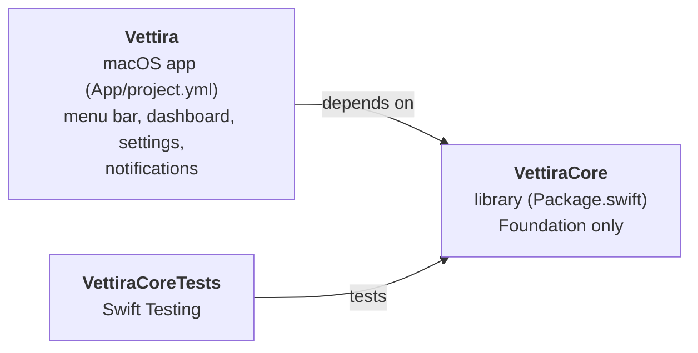
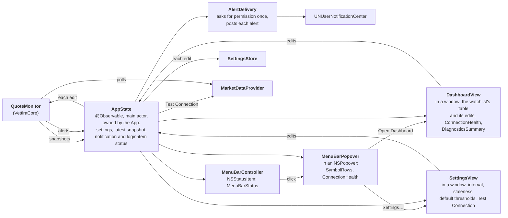
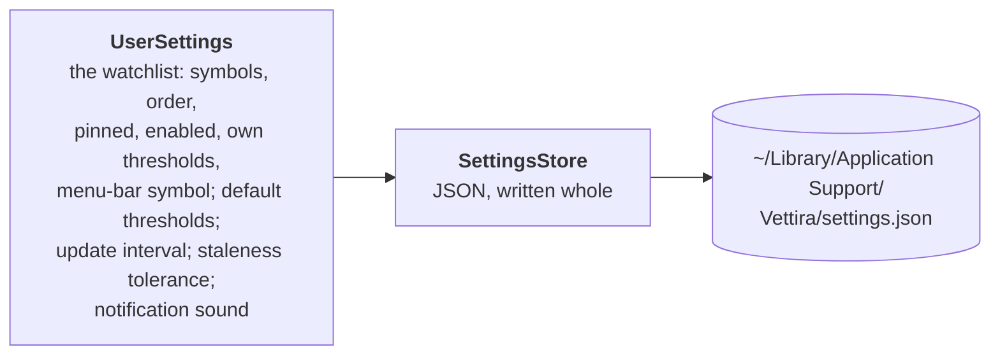
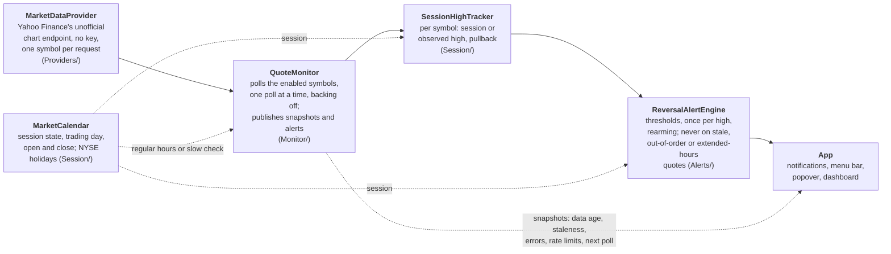
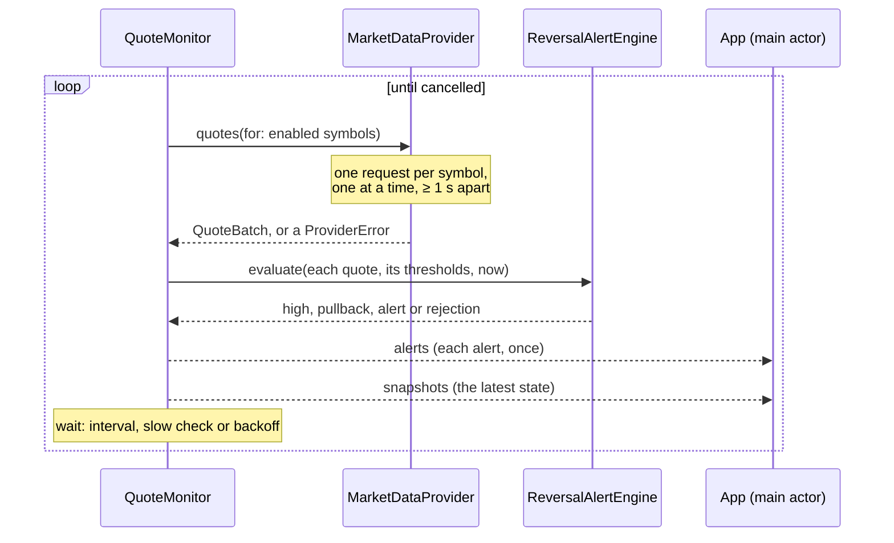

# Architecture

**Code:** `Package.swift`, `Sources/VettiraCore/`, `App/`.

Vettira is a Swift package, `VettiraCore`, holding the app's logic, and a macOS app, `Vettira`,
that shows it in the menu bar and a dashboard window. The logic uses Foundation only, so its tests
run with `swift test` and need no UI and no network: they use recorded and mock quotes.

## Targets

| Target | Where | What it is |
|---|---|---|
| `VettiraCore` | `Sources/VettiraCore/` | The logic: quotes and the market-data provider protocol (`Providers/`), the market session and session-high tracking (`Session/`), the reversal alert engine (`Alerts/`), the quote monitor that polls and publishes (`Monitor/`), what the menu bar and its popover show (`Display/`), notifications' wording and delivery (`Notifications/`), local storage (`Storage/`), a Debug run's launch arguments (`LaunchOptions`) |
| `VettiraCoreTests` | `Tests/VettiraCoreTests/` | Its tests, on recorded and mock quotes |
| `Vettira` | `App/Vettira/` | The app, from `App/project.yml` with [XcodeGen](https://github.com/yonaskolb/XcodeGen): an `NSStatusItem` with an `NSPopover`, a dashboard window and a Settings window, each hosting SwiftUI views. Bundle ID `com.andiamosoftware.vettira`, macOS 14 and later, a menu-bar app (`LSUIElement`): it shows in the Dock only while one of its windows is open |

The Xcode project is generated, never committed: `cd App && xcodegen`, then open
`App/Vettira.xcodeproj`.

## The app

The menu-bar item is the app: it runs until the user picks **Quit**. `MenuBarController`
(`App/Vettira/MenuBarController.swift`) puts it in the menu bar as an `NSStatusItem` whose button
toggles a transient `NSPopover`, and the popover's **Open Dashboard** opens the dashboard window
and its **Settings…** the Settings window (as do the dashboard's **Settings…** and the app menu's,
Cmd-,); each hosts SwiftUI views (`NSHostingController`). Closing the popover or a window leaves
the menu-bar item, and monitoring, running.

**The Dock.** Vettira is a menu-bar app, so it has no Dock icon, except while one of its windows
is open: then it shows in the Dock and the app switcher (`NSApp.setActivationPolicy(.regular)`),
so the window can be found like any app's, and has its app menu. When the last one closes it
goes back to the menu bar only (`.accessory`); a minimized window still counts as open.
`DockPresence` (`VettiraCore`, `Display/`) keeps which windows are open and says when that
changes, and `MenuBarController`, each window's delegate, applies it.

Why AppKit rather than SwiftUI's `MenuBarExtra`: a window-style `MenuBarExtra` (the kind that
shows a popover rather than a menu) opens only on a real mouse event, so neither accessibility
(VoiceOver, UI scripts) nor the app itself can open it. The status item's button action is the
one a click, an accessibility press and VoiceOver all take, and the button's accessibility is the
app's to set.

**The app's state.** `AppState` (`App/Vettira/AppState.swift`) is `@Observable`, on the main
actor, and owned by the app's delegate (`App/Vettira/VettiraApp.swift`) from launch until Quit,
not by a view. At launch it loads the settings
(`SettingsStore.applicationSupport()`), starts the `QuoteMonitor` on Yahoo Finance's provider,
and reads both of its streams for as long as the app runs: each snapshot replaces the last, and
each alert goes to `AlertDelivery`. The menu bar (which redraws as the state it reads changes),
the popover, the dashboard and Settings read it, and change the settings only through its
methods, so opening or closing a window changes nothing, and reopening one shows the same state.
It also moves its own clock every 5 seconds, so the menu bar turns stale on time between polls,
and the popover and dashboard redraw every second while they're open, so data ages count up.

**What it shows.** What the views show is worked out in `VettiraCore` (`Display/`), so it's
tested without a UI:

| Type | What it is |
|---|---|
| `MenuBarStatus` | The menu bar: the menu-bar symbol (`watchlist.menuBarSymbol`), its price and change from the high (`SPY 512.30 −0.31%`), or why there's none: waiting, off, market closed, stale, or no quote. While a warning that fired this session is still passed, its icon says so, and its tooltip says "possible reversal, not confirmed". Outside regular hours it says closed, and a quote older than the staleness tolerance is stale even between polls |
| `SymbolRow` | A watchlist symbol in the popover and the dashboard, pinned first: price, high and whether it's the session or the observed high, change from the high, the quote's own time and its data age, why its data can't alert (off, waiting, unknown symbol, market closed, stale, unconfirmed jump), its thresholds and whether they're its own, and the last warning this session; and whether a search finds it. Clicking one in the popover shows it in the menu bar |
| `ConnectionHealth` | Waiting, connected, outside regular hours, or failing with the provider error's message and next step; when data last came and when the next update is |
| `DiagnosticsSummary` | The dashboard's diagnostics, label and value: the source, the update interval in and outside regular hours, the staleness tolerance, when quotes last came, the last and next update, the last error and how many updates in a row have failed |
| `ConnectionTestReport` | What Settings' Test Connection found: the quote with its time, age and source; that it's stale, in regular hours; the last session's price, while the market is closed; or the provider error's message and next step. `run(on:symbol:…)` asks the provider |
| `SettingsChoices` | The update intervals (10 s to 1 h) and staleness tolerances Settings offers, the saved value always among them, and a warning when the tolerance is shorter than the interval, so quotes would turn stale between updates |
| `DockPresence` | Which windows are open, so whether Vettira shows in the Dock |

The menu-bar item's accessibility label (its description) is always "Vettira", whatever it
shows, so VoiceOver names it and UI scripts can find it, and its accessibility value is the status
in full, which changes with it. Its accessibility title stays the text it shows (the ticker and
price): macOS reports a status item's title from its button's text.

**Notifications.** `AlertDelivery` (`Sources/VettiraCore/Notifications/`) posts each alert
through `UNUserNotificationCenter`, with a sound unless the user turned it off (**Alert sound**
in the popover, saved in the settings). It asks for permission at launch when a symbol is
monitored, the first moment an alert can come, or at the first alert otherwise; the system asks
the user once. When notifications are off, alerts only show in the menu bar and the popover, and
the popover says so with a button to System Settings. `AlertNotification` words it as a possible
reversal, never advice: the ticker, the price, the high and its kind, the drop from the high, the
warning and its threshold, and the quote's own time and age:

> **SPY: possible reversal, not confirmed** 
> Early warning (0.25% threshold) 
> 512.30 is 0.30% below the observed high of 513.84. Quote at 10:31:05 EST, 5 s old, from Yahoo
> Finance (unofficial).

Banners show even while Vettira's popover or dashboard is open (`NotificationPresenter`).

**The dashboard** (`DashboardView`) is the watchlist as a table, a `SymbolRow` a row, with the
controls to edit it: add a symbol (checked as a `TickerSymbol`, saying why when it isn't one, or
is already on the list), search, reorder (drag a row while the list isn't filtered, or its up and
down arrows; pinned symbols stay first), pin, switch a symbol on or off, give it its own
thresholds or put it back on the defaults, pick the menu bar's symbol, and remove it. Under the
table are the connection's health and its diagnostics.

**Settings** (`SettingsView`) has the update interval and the staleness tolerance, the default
thresholds, where quotes come from with Yahoo's terms, **Test Connection**, and the alert sound
and Launch at Login switches. Thresholds are typed as percents and checked together
(`PullbackThresholds(early:strong:)` from text), saying why when they're refused. Test Connection
asks the monitor's own provider for one quote for the menu-bar symbol (SPY while the watchlist is
empty), so its request waits behind any of the monitor's and keeps to the same pacing; it's
user-triggered, one at a time, and in a demo run asks the demo provider.

**Every edit**, in the dashboard, Settings or the popover, goes through `AppState`: it's made on a
copy of the settings, which is saved whole straight away and handed to the monitor
(`update(settings:)`), so it applies from the next poll and survives a relaunch. An edit the
settings' types refuse changes nothing.

**Launch at Login** is a switch in the popover and in Settings, off until the user turns it on. It registers the
app with `SMAppService.mainApp`; when macOS wants the user to approve it, the popover says so and
opens Login Items.

**Debug launch options.** A Debug build reads its launch options (`LaunchOptions`, in
`VettiraCore`), each as a launch argument or an environment variable: `--demo`
(`VETTIRA_DEMO=1`), for the demo provider's made-up prices
([providers.md](providers.md#the-demo-provider)) on a clock moved into regular hours, and
`--settings-dir <path>` (`VETTIRA_SETTINGS_DIR`), for a settings file somewhere other than
Application Support, so the app can be run and checked without calling Yahoo or touching the
user's settings. Either one makes the run a check (`isCheck`), whose alerts go only to the log
(`LogNotificationCenter`, each notification's full text) and which never asks for notification
permission, unless it's also launched with `--notify` (`VETTIRA_NOTIFY=1`). A check also neither
reads nor saves its windows' frames (`remembersWindowFrames`): they live in the app's defaults,
which the user's own Vettira shares, so a check's windows open at their first size each launch. Release builds ignore
them all.

## Storage

What the user sets up stays on their Mac, in one file, as [PRIVACY.md](../PRIVACY.md) promises.

`UserSettings` (`Sources/VettiraCore/Storage/`) holds the `Watchlist` and the default
`PullbackThresholds`; `SettingsStore` saves it as JSON in
`~/Library/Application Support/Vettira/settings.json`, replacing the file whole on each save. It
also holds whether notifications play a sound, the update interval (`MonitorSettings`, saved as
`updateInterval` in seconds) and the alert engine's settings, of which only the staleness
tolerance is the user's and saved (`staleTolerance`, in seconds; the rest are the standard ones).
Input is checked where it comes in, into types that can't hold a bad value: a `TickerSymbol` is
trimmed, uppercased, 1 to 15 of `A-Z 0-9 . - ^ =`; thresholds are each between 0 and 100
percent, early below strong; the watchlist has each symbol once, and its menu-bar symbol is on
it; the update interval is from 10 seconds to an hour, and the staleness tolerance more than 0. Decoding goes through the same checks, so a file that breaks them is corrupt: the store moves
it to `settings.corrupt.json` and starts from the defaults (an empty watchlist, 0.25% and
0.40%, a 15-second interval and a 60-second tolerance). A field an older file lacks gets its default, so a new setting is added with
`decodeIfPresent` and a default.

## The pipeline

How a quote becomes an alert. Each box is a part of `VettiraCore` except the last, which is the
app.

The provider reads Yahoo Finance's unofficial, undocumented JSON chart endpoint
(`v8/finance/chart`), which takes one symbol per request: each poll sends one request per enabled
symbol, one at a time and at most one a second, backing off when Yahoo rate-limits or errors.
Yahoo doesn't support or endorse it, it can change or be blocked without notice, and Yahoo's
terms govern its use; [spec.md](spec.md) says what that data is and isn't. The `MarketDataProvider`
protocol keeps the rest of the pipeline independent of it, so a licensed or streaming provider
can be added later. The protocol, the normalized quote, the provider's requests and its errors
are in [providers.md](providers.md).

The market calendar is built: for any instant it gives the US regular session's state, the
trading day it belongs to and that session's open and close, from NYSE's published holidays and
early closes. So are the session-high tracker and the alert engine: per symbol, the engine
rejects a quote that isn't fresh, in order and in regular hours, keeps the session or observed
high, and fires each threshold once per high-water-mark cycle, with a `Codable` state the app can
save. [alerts.md](alerts.md) describes the session rules, the years the calendar covers, and when
alerts fire. The monitor is built too ([below](#polling)), and so are the app's menu bar,
popover, notifications, dashboard and Settings ([above](#the-app)).

An alert is a possible, unconfirmed reversal, never advice or an instruction to sell, and its
thresholds are illustrative. The spec is [spec.md](spec.md).

## Polling

`QuoteMonitor` (`Sources/VettiraCore/Monitor/`) is an actor that polls the watchlist's enabled
symbols through the `MarketDataProvider`, runs each quote through the `ReversalAlertEngine`, and
publishes what it knows. The app starts it once, in its shared state, with `run()` in a task it
keeps for as long as the app runs, and stops it by cancelling that task; closing the dashboard
doesn't touch it.

**How often.** One poll at a time: `run()` does nothing if it's already running, and the provider
sends a poll's requests one after another, at least a second apart. The next poll waits for the
update interval (`MonitorSettings.interval`, set in Settings: 15 seconds by default, from 10
seconds to an hour) from the start of the last one, so with one symbol it's one request every 15
seconds. The wait is
never shorter than the poll took, so Vettira is idle at least half the time: a 20-symbol
watchlist, which takes about 20 seconds at one request a second, waits 20 seconds after each poll
rather than polling back to back.
Outside regular hours (pre-market, after-hours, overnight, weekends, holidays, or a date the
calendar doesn't cover) it only checks every 10 minutes, or every interval when that's longer;
in the pre-market it checks no later than the open, so regular-hours polling starts on time.

**Backoff.** A poll that fails (rate limited, blocked, unreachable, unreadable) waits the update
interval doubled for each failure in a row, 30 s, 60 s, 120 s and so on with the default, up to
15 minutes (or the interval, when that's longer), and never less than the regular wait. A rate
limit's `Retry-After` is honoured, even past the cap. The first poll that succeeds goes back to the
normal interval. A symbol the provider doesn't know, or has no usable quote for, isn't a failure:
it's marked on that symbol, and the rest update.

**What it publishes.** Two `AsyncStream`s, each read by one consumer, the app's shared state on
the main actor (`for await snapshot in monitor.snapshots { … }`), so `VettiraCore` needs no
SwiftUI:

| Stream | What | Buffer |
|---|---|---|
| `snapshots` | A `MonitorSnapshot` after each poll and each settings change, starting with the state before the first poll | The latest only: a consumer that falls behind skips to it |
| `alerts` | Each `ReversalAlert` as it fires, once, for notifications | Every alert, none dropped |

A snapshot holds, for each enabled symbol (`SymbolSnapshot`): the latest quote, its data age when
the snapshot was taken, whether it's stale, the high and whether it's the session or the observed
high (only for the current trading day's session), the pullback, why the engine couldn't use the
latest quote if it couldn't, the last alert, and why the provider had no quote for it if it
didn't. Its diagnostics (`MonitorDiagnostics`) are the source, the market state, when the last
poll finished and when quotes last came back, the wait before the next poll and when it's due,
the last error with its message and next step, and how many polls in a row have failed.

**Stale data.** A symbol is stale when it has no quote yet, its quote is older than the staleness
tolerance (`AlertSettings.staleTolerance`, 60 seconds by default, set in Settings), or the provider says it's
delayed by more. The engine fires nothing on a stale quote ([alerts.md](alerts.md)), so price
alerts are suspended until fresh data comes, and the app shows the symbol as stale. When the
provider stops answering, each snapshot's data age keeps growing until the symbol turns stale.
Outside regular hours a symbol's latest quote is the last session's, so it turns stale once that
quote is older than the tolerance: by default, a minute after the close.

**Settings and saved state.** The monitor takes its update interval and alert settings from the
`UserSettings` it's given, and `update(settings:)` takes new ones: a symbol added or enabled is
listed straight away and polled from the next poll, and one removed or disabled is dropped; new
thresholds and a new staleness tolerance apply from the next quote (the tolerance to the snapshot
it publishes at once), and a new interval from the wait after the next poll. The engine's state is `engineState`, `Codable`, and `init` takes it back,
so the app can save it and a relaunch doesn't alert again for a pullback it already alerted.

Its tests (`Tests/VettiraCoreTests/Monitor/`) drive it with a fake provider and a clock that only
moves when the monitor waits, so no test waits on the wall clock or calls Yahoo.
