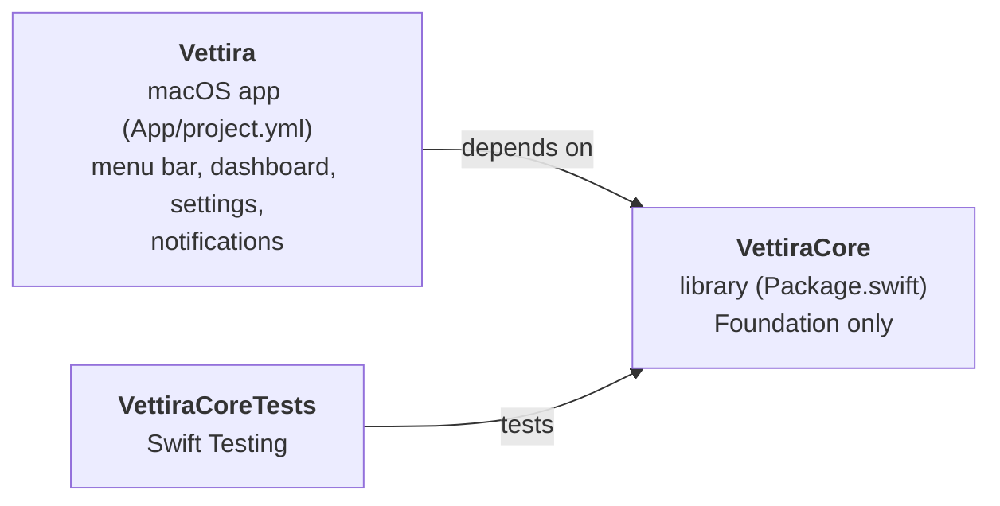
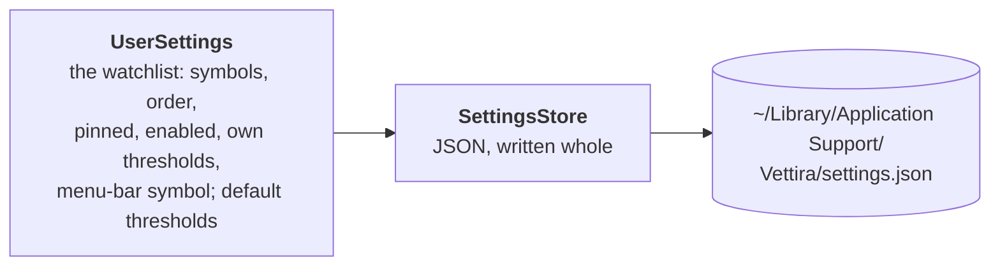
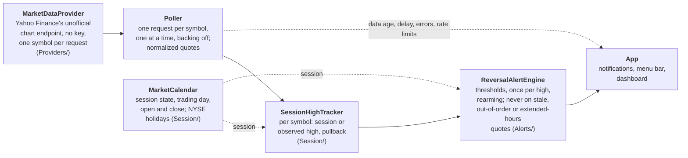

# Architecture

**Code:** `Package.swift`, `Sources/VettiraCore/`, `App/`.

Vettira is a Swift package, `VettiraCore`, holding the app's logic, and a macOS app, `Vettira`,
that shows it in the menu bar and a dashboard window. The logic uses Foundation only, so its tests
run with `swift test` and need no UI and no network: they use recorded and mock quotes.

## Targets

| Target | Where | What it is |
|---|---|---|
| `VettiraCore` | `Sources/VettiraCore/` | The logic: quotes and the market-data provider protocol (`Providers/`), the market session and session-high tracking (`Session/`), the reversal alert engine (`Alerts/`), local storage (`Storage/`) |
| `VettiraCoreTests` | `Tests/VettiraCoreTests/` | Its tests, on recorded and mock quotes |
| `Vettira` | `App/Vettira/` | The app, from `App/project.yml` with [XcodeGen](https://github.com/yonaskolb/XcodeGen): a `MenuBarExtra` and a dashboard `Window`. Bundle ID `com.andiamosoftware.vettira`, macOS 14 and later, menu bar only (`LSUIElement`), so it has no Dock icon |

The Xcode project is generated, never committed: `cd App && xcodegen`, then open
`App/Vettira.xcodeproj`.

## The app

The menu-bar item is the app: it runs until the user picks **Quit** from its menu. The dashboard is
a separate `Window` scene the menu opens (**Open Dashboard**); closing it leaves the menu-bar item,
and monitoring, running. Monitoring will belong to the app's shared state, not to the dashboard's
views, so it doesn't stop or restart when the window closes or opens.

So far the app is the shell: a menu with Open Dashboard and Quit, and an empty dashboard.

## Storage

What the user sets up stays on their Mac, in one file, as [PRIVACY.md](../PRIVACY.md) promises.

`UserSettings` (`Sources/VettiraCore/Storage/`) holds the `Watchlist` and the default
`PullbackThresholds`; `SettingsStore` saves it as JSON in
`~/Library/Application Support/Vettira/settings.json`, replacing the file whole on each save.
Input is checked where it comes in, into types that can't hold a bad value: a `TickerSymbol` is
trimmed, uppercased, 1 to 15 of `A-Z 0-9 . - ^ =`; thresholds are each between 0 and 100
percent, early below strong; the watchlist has each symbol once, and its menu-bar symbol is on
it. Decoding goes through the same checks, so a file that breaks them is corrupt: the store moves
it to `settings.corrupt.json` and starts from the defaults (an empty watchlist, 0.25% and
0.40%). A field an older file lacks gets its default, so a new setting is added with
`decodeIfPresent` and a default.

## The pipeline (planned)

How a quote becomes an alert, once the parts are built. Each box is a part of `VettiraCore`
except the last, which is the app.

The provider reads Yahoo Finance's unofficial, undocumented JSON chart endpoint
(`v8/finance/chart`), which takes one symbol per request: each poll sends one request per enabled
symbol, one at a time and at most one a second, backing off when Yahoo rate-limits or errors.
Yahoo doesn't support or endorse it, it can change or be blocked without notice, and Yahoo's
terms govern its use; [spec.md](spec.md) says what that data is and isn't. The `MarketDataProvider`
protocol keeps the rest of the pipeline independent of it, so a licensed or streaming provider
can be added later. The protocol, the normalized quote, the provider's requests and its errors
are in [providers.md](providers.md).

The market calendar is built: for any instant it gives the US regular session's state, the
trading day it belongs to and that session's open and close, from NYSE's published holidays and
early closes. [alerts.md](alerts.md) describes the session rules and the years it covers.

An alert is a possible, unconfirmed reversal, never advice or an instruction to sell, and its
thresholds are illustrative. The spec is [spec.md](spec.md).
