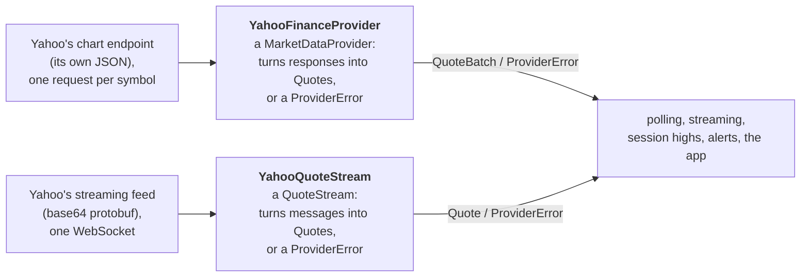

# Market-data providers

**Code:** `Sources/VettiraCore/Providers/`.

Vettira reads quotes from Yahoo Finance's chart endpoint: one of the unofficial JSON endpoints its
web pages use, which the [yfinance](https://github.com/ranaroussi/yfinance) project also reads. In
regular hours, prices also stream in between polls from Yahoo's streaming quote feed, the
WebSocket its pages get live prices from, which yfinance reads too
([Streamed prices](#streamed-prices)). Neither needs a key, an account or a cookie, and there's
nothing to set up.

## Read this first

- **Unofficial and undocumented.** Yahoo has no public market-data API. Neither the chart endpoint
  nor the streaming feed is published, documented or supported for use by other apps.
- **Not licensed or endorsed by Yahoo.** Vettira isn't affiliated with Yahoo, Yahoo hasn't
  approved this use, and nothing here gives you any right to Yahoo's data.
- **Yahoo's terms govern your use.** Yahoo's terms of service apply to its data and to how it's
  reached: read them at [legal.yahoo.com](https://legal.yahoo.com/us/en/yahoo/terms/otos/index.html).
  Among other things, they restrict collecting data by automated means, commercial use and
  high-volume use, each without Yahoo's permission, and Vettira has no permission from Yahoo.
  Whether your use follows them is between you and Yahoo, and you're responsible for it. Vettira
  is for personal, non-commercial use on your own Mac; don't redistribute the data.
- **It can break or be blocked without notice.** Yahoo can change the endpoint or the feed, limit
  how often they answer, or refuse requests from apps like Vettira, from your network or from your region,
  at any time. When it does, Vettira shows the error and has no quotes until it works again.
- **Possibly delayed.** A quote can lag the exchange, and neither the endpoint nor the feed says
  by how much.
  Each quote carries its own time, so its age shows any delay and a stale quote can be kept from
  firing an alert.
- **Not consolidated.** A quote is Yahoo's view of the market, not the consolidated tape across
  every exchange.
- **Not tick-by-tick.** Outside the stream, Vettira asks for quotes at an interval and sees the
  latest price at that moment, not every trade between. The stream sends prices as they change,
  but Vettira takes at most one a second for each symbol, and each carries a time to the second.
- **Its high may be observed.** When Yahoo supplies the regular session's high, Vettira uses it as
  the session high. When it doesn't, the only high Vettira has is the highest price it saw in the
  quotes and in the day's 5-minute bars that came with them, which it labels the "observed high"
  ([alerts.md](alerts.md#the-days-bars)); it can be lower than the day's actual high.

## What Vettira sends, and keeps

One request per symbol in the watchlist, each time it updates, and in regular hours one streaming
connection ([Streamed prices](#streamed-prices)):

| Request | What for |
|---|---|
| `GET https://query1.finance.yahoo.com/v8/finance/chart/<symbol>?range=1d&interval=5m&includePrePost=false` | The symbol's latest quote, in the chart's `meta`, and the day's regular-session bars, five minutes each, for the popover's and the dashboard's small charts and the chart window's 1D |
| `GET https://query1.finance.yahoo.com/v8/finance/chart/<symbol>?range=<range>&interval=<interval>&includePrePost=false` | Only when you pick a timeframe in a symbol's chart window, one request for that symbol and timeframe ([History for the chart](#history-for-the-chart)) |

- **One at a time, at most one a second.** Requests go one after another, never in parallel,
  with at least a second between any two, so a watchlist of ten symbols takes about ten seconds
  to update.
- **An honest User-Agent:** `Vettira (https://github.com/nikpietanze/vettira)`, never a browser's.
- **Nothing about you** beyond what any web request carries, like your IP address: no key, no
  cookie, no account. Vettira keeps nothing from the responses but the quotes and the day's bars,
  in memory, each replaced by the next update's.
- **The chart costs no extra request.** The day's bars come in the same response as the quote.
- It reads no web pages, follows no consent forms, and downloads no history in the background:
  each update's bars are the current day's only (`range=1d`), or the last session's while the
  market is closed. Longer history is asked for only when you open it in a chart.
- **A chart's timeframe** is the other request you trigger yourself
  ([History for the chart](#history-for-the-chart)), sent in turn with the updates' requests and
  at the same pace.
- **Test Connection**, in Settings, is the one request you trigger yourself: one quote for the
  menu-bar symbol (SPY while the watchlist is empty), sent in turn with the updates' requests and
  at the same pace, never alongside one. It says what came back: the quote with its time and age;
  that it's stale (older than the staleness tolerance in regular hours); the last session's price
  while the market is closed; or the error below, each with its own message and what to do.

If Yahoo rate-limits a request (HTTP 429), refuses it (HTTP 403), redirects it to a consent page,
or is down, the update stops there, since the remaining symbols would fail the same way. A symbol
Yahoo doesn't know (HTTP 404, "No data found, symbol may be delisted"), or returns without a usable
price or time, is listed on its own, and the rest of the watchlist still updates.

From each response it reads the regular session's fields only, from `chart.result[0]`:

| Yahoo's field | Becomes |
|---|---|
| `meta.regularMarketPrice` | the price |
| `meta.regularMarketTime` | the quote's time (seconds since 1970) |
| `meta.regularMarketDayHigh` | the session high, when present |
| `meta.currentTradingPeriod.regular` | the session: regular when the quote's time falls in the day's regular period (its close included), closed otherwise, unknown without the period |
| `meta.chartPreviousClose` | the previous close, when present: what the day's change, up or down, is measured from |
| `meta.longName`, or `meta.shortName` | the security's name, for the chart window's heading |
| `meta.regularMarketVolume` | the day's volume, for the chart window's figures |
| `meta.regularMarketDayLow` | the regular session's low, for the chart window's figures |
| `timestamp`, `indicators.quote[0].close` and `.high`, and `.open`, `.low` and `.volume` when present | the day's bars: each bar's start time, last price and highest price, then its first and lowest price and volume, for the charts and, when there's no `regularMarketDayHigh`, the observed high. A bar Yahoo has no price for (`null`) is a gap in the chart, and a bar whose time isn't after the one before is dropped. Bars that can't be read leave the quote without a chart, never without a quote |

The endpoint declares no delay, so a quote has none (`providerDelay` is empty), and its age is
what shows how current it is. Outside the regular session the price, time and high are the last
regular session's, and an extended-hours price is never read: `includePrePost=false` keeps the
bars to the regular session too.

## History for the chart

Clicking a symbol in the dashboard or the popover opens its chart, with timeframes 1D, 5D, 1M,
6M, YTD, 1Y and 5Y. Each is one chart-endpoint request with its own range and interval
(`YahooFinanceProvider.history(for:timeframe:)`), regular session only:

| Timeframe | `range` | `interval` | Kept for |
|---|---|---|---|
| 1D | `1d` | `5m` | no request while the symbol updates: the updates bring these bars |
| 5D | `5d` | `15m` | 15 minutes |
| 1M | `1mo` | `60m` | an hour |
| 6M, YTD, 1Y | `6mo`, `ytd`, `1y` | `1d` | 4 hours |
| 5Y | `5y` | `1wk` | 12 hours |

`ChartHistoryStore` keeps this to the light-client rule, the one exception to downloading no
history:

- **Only when you open it.** Nothing is fetched ahead of time or in the background: a request is
  sent when you pick a timeframe whose history isn't kept, for that one symbol and timeframe.
- **Through the same pacing.** It waits its turn behind any update's request in flight, never
  alongside one, and keeps to at most one request a second.
- **Kept in memory, for about a bar** (the table), so picking a timeframe again, or reopening the
  window, sends nothing. Picking it while its request is in flight waits for that request. Nothing
  is written to disk, and the history is gone when Vettira quits.
- **1D needs no request** while the symbol is monitored: its bars come with each update, so the
  chart moves with them. A symbol that's off asks once, kept for 5 minutes.
- **Backs off.** After Yahoo rate-limits (for as long as it asked, at least a minute), refuses or
  can't be reached, no history is asked for at all for a minute; after any other failure, not
  that symbol and timeframe.

From each response it reads `meta.symbol`, `meta.longName` (or `shortName`) for the window's
heading, `meta.chartPreviousClose` (the close before the first bar, what the period's change is
measured from) and the bars' `timestamp` with `indicators.quote[0]`'s `open`, `high`, `low`,
`close` and `volume`. A bar with no `close` (`null`) is a gap in the line. The line ends at the
symbol's latest quote, so between requests it moves with the updates. A symbol Yahoo doesn't know
throws `unknownSymbols`, and the window shows each error's message and next step.

The chart window's figures (open, high, low, previous close, volume) are the day's, from the
updates' own response, `meta.regularMarketVolume` among them: they need no request. Its High and
Low are Yahoo's `regularMarketDayHigh` and `regularMarketDayLow` only, a dash without them: a high
Vettira works out from the bars and prices it saw is the observed high, shown as that.

## Streamed prices

In regular hours (09:30 to the close, New York time, by Vettira's market calendar), while at least
one symbol is on, Vettira keeps one connection open to Yahoo's streaming quote feed, and prices
come as they change instead of only at each update.

| Connection | What for |
|---|---|
| `wss://streamer.finance.yahoo.com/?version=2` | One WebSocket for the whole watchlist. Vettira sends `{"subscribe":["SPY","AAPL"]}` with the enabled symbols, and, as the watchlist changes, `{"subscribe":[…]}` for symbols turned on and `{"unsubscribe":[…]}` for those taken off or turned off, on the same connection |

- **One connection, only when it's needed.** It opens at the open's update and closes at the
  first update after the close, or as soon as no symbol is on. The same User-Agent, no cookie, no
  key.
- **Updates slow down while it's live.** Polls in regular hours come a minute apart (or at the
  update interval, if that's longer), since they only refresh each symbol's day: its bars, the
  previous close and the session high. The stream has none of those, and sends nothing for a
  symbol until its price next changes, so the chart endpoint also brings each symbol's first
  quote.
- **Polling takes over when it drops.** When the connection fails or closes, the next update
  comes an update interval after the last one started, and updates go on at that interval. Vettira
  reconnects after 5 seconds, doubling the wait after each failure in a row, up to 5 minutes (or
  longer if Yahoo asks), and the wait starts over once a price comes through. Every 30 seconds it
  pings the server, and treats a connection that doesn't answer within 15 as dropped.
- **At most once a second.** Vettira keeps the latest streamed price for each symbol and hands
  them to the alert engine and the menu bar at most once a second.

Each message is a text frame, `{"type":"pricing","message":"<base64>"}`, whose message is a
protobuf `PricingData` (the schema yfinance's `pricing.proto` describes). Vettira decodes it with
its own small decoder and reads four fields; every other field is skipped:

| Field | Becomes |
|---|---|
| `id` (1, string) | the symbol |
| `price` (2, float) | the price, as the shortest decimal that float holds (753.42, not 753.4199829…) |
| `time` (3, sint64, milliseconds since 1970) | the quote's time; Yahoo sends it to the whole second |
| `marketHours` (7) | only 1, the regular session, is read. Pre-market (0), post-market (2) and extended or overnight trading (3, 4) prices are dropped, so an extended-hours price is never read |

A streamed quote has no session high, previous close or bars of its own: it takes those from the
symbol's last polled quote from the same session, and has none before the session's first poll.
The feed's own day high isn't read, since it isn't known to be the regular session's high. A
streamed price no newer than the symbol's latest quote is ignored, and a poll whose quote is
older than the latest streamed price leaves that price in place and brings only its day. Every
streamed quote goes through the same alert engine as a polled one, so a stale, out-of-order or
extended-hours one never fires an alert.

Messages that aren't prices are skipped. A message that isn't the JSON or the protobuf Vettira
expects closes the connection as `malformedResponse`, and polling takes over while it reconnects.
A refused connection is `blocked` (HTTP 403) or `rateLimited` (HTTP 429), and any other failure,
a dropped connection included, `unavailable`.

## How a provider plugs in

Everything past the provider (polling, session highs, alerts, the app) depends on the
`MarketDataProvider` protocol, the `QuoteStream` protocol and the `Quote` they return, never on
Yahoo, so a licensed provider can be added later as one new type that conforms to them.

A `MarketDataProvider` has:

| Member | What it does |
|---|---|
| `name` | The provider's name, shown as each quote's source: "Yahoo Finance (unofficial)" |
| `quotes(for:)` | The latest quotes for many symbols, in as few requests as the provider allows (Yahoo's: one per symbol, paced). Symbols it doesn't know come back in the batch's `unknownSymbols`, and symbols it returned without a usable price or time (a halted or newly listed symbol, say) in its `unusableSymbols`; the rest of the batch still comes. Only a response that can't be read at all fails the batch |
| `testConnection(symbol:)` | One quote for one symbol, for Test Connection in Settings: by default one `quotes(for:)` call, so it goes through the same requests and pacing as a poll, waits behind any poll's request in flight, and counts against the one-request-a-second limit. It returns the quote, or throws why there's none: the provider's error, `unknownSymbols` or `noUsableQuote` for the symbol, or `malformedResponse` when nothing came back for it |
| `history(for:timeframe:)` | One symbol's bars over a `ChartTimeframe` (`PriceHistory`: the bars, the close before them and the security's name), in one request through the same pacing. Only `ChartHistoryStore` calls it, when the user opens a timeframe ([History for the chart](#history-for-the-chart)) |

A `QuoteStream` (Yahoo's is `YahooQuoteStream`) has a `name`, the source its quotes show, and
`connect()`, which returns a `QuoteStreamConnection`: `subscribe(_:)` and `unsubscribe(_:)`
symbols, `next()` for the next regular-session quote (it throws once the connection fails or
closes), and `close()`. `QuoteStreamer` keeps one connection open for the monitor
([architecture.md](architecture.md#streaming)).

Providers reach the network only through `HTTPClient`, and streams through `WebSocketClient`, so
their tests answer with recorded responses and messages and never call Yahoo.

### A quote

| Field | What it is |
|---|---|
| `symbol` | The ticker, as the provider returned it |
| `price` | The last price |
| `timestamp` | When the provider says the price was set, not when Vettira received it; `age(at:)` is the time since |
| `source` | The provider's name |
| `sessionHigh` | The regular session's high, only when the provider supplies it as that; otherwise empty, and Vettira's own high is the observed high |
| `session` | Pre-market, regular, post-market, closed, or unknown, as the provider reports it |
| `providerDelay` | How far behind the exchange the provider says its data is, when it says |
| `previousClose` | The previous regular session's close, when the provider supplies it |
| `intraday` | The day's regular-session bars, oldest first (`PriceBar`: start time, last price or none for a gap, and when the provider has them the highest price, first price, lowest price and volume): today's, or the last session's while the market is closed. Empty when the provider returned none |
| `name` | The security's name, when the provider supplies it, for the chart window's heading |
| `dayVolume` | The shares traded in the regular session so far, when the provider says |
| `sessionLow` | The regular session's low, only when the provider supplies it as that |

### Errors

Each error says what happened and what you can do about it. None includes the provider's raw
response.

| Error | When | What to do |
|---|---|---|
| `rateLimited` | Too many requests in a short time (HTTP 429), with how long to wait when the provider says so in whole seconds (`Retry-After`, capped at a day; anything else is no wait given); the update stops there | Wait; if it keeps happening, lengthen the update interval |
| `blocked` | The provider refused the request (HTTP 403), or redirected it to a consent page | Try later; some networks and regions are blocked, and Vettira can't accept a consent page for you |
| `unknownSymbols` | The provider doesn't recognize these symbols | Check the spelling and use the provider's ticker |
| `noUsableQuote` | The provider returned these symbols with no usable price or quote time. In a batch they're listed in `unusableSymbols`; Test Connection throws it, and `unknownSymbols` for a symbol the provider doesn't know | The symbol may be halted or newly listed; check again later |
| `malformedResponse` | The response couldn't be read: not the expected JSON, or an unexpected status | Try later; if it persists, the provider may have changed its responses, so report it |
| `unavailable` | No network, or the provider had a server error (HTTP 5xx) | Check the connection; otherwise try later |

## The demo provider

`DemoProvider` makes up prices, so the app can be tried and checked without calling Yahoo. The
app uses it only in a Debug build launched with `--demo` ([the README](../README.md) and
[architecture.md](architecture.md#the-app) say how); a release build
always uses Yahoo's. Its name, "Demo (made-up prices)", is every quote's source, so the popover,
the dashboard and each notification say the prices aren't real.

Each symbol starts at its own base price, from 100 to 499 and the same on every run, and moves
one step per poll through a fixed path, in percent above the base: 0, 0.10, 0.20, 0.30, 0.15,
0.00, −0.15, −0.10, then it holds at −0.10. Its high, the observed one, is 0.30% above the base,
so with the default thresholds the sixth poll is 0.30% below it (an early warning), the seventh
0.45% (a stronger warning), and nothing alerts after that. Every other symbol (the symbol decides,
`DemoProvider.path(for:)`) skips the 0.15 step, so it warns a poll earlier and on the seventh
poll is rising again while the others fall: the menu bar shows prices both rising and falling. Each quote is timestamped at the
monitor's clock, in the regular session, with no session high. The app moves the monitor's clock
into the regular session (`DemoProvider.regularHoursOffset`), to 14:00 in New York (an hour
before an early close) in the session the moment belongs to, so the demo alerts at any time of
day and its day's chart has most of a session to show. It polls at the update
interval in the settings, so at 10 seconds the early warning comes about a minute after launch.
Its Test Connection returns the symbol's quote at its current step without moving it on, so
testing doesn't change when the warnings come.

Its history for every timeframe is made up too, so the chart window can be tried without Yahoo:
a random walk, the same on every run for each symbol and timeframe, on the market's trading days
(weekdays where the calendar doesn't reach) in regular hours, ending at the symbol's demo price,
with opens, highs, lows and volumes. Its 1D is the quote's own day.

Each quote has a made-up day for the chart too: a previous close 0.60% below the base price or
above it (the symbol decides which, so a watchlist shows days both up and down), and a 5-minute
bar from the open of the moment's session up to that moment, wandering from below the base price
to the quote's own price, each opening at the last one's close, with a made-up volume. Each bar's high is the higher of its close and the one before, so no
bar's high is above the prices the quotes reach: the bars count in the observed high
([alerts.md](alerts.md#the-days-bars)) but never raise it, and the warnings come when the
path says. Outside the regular session it has no bars.
