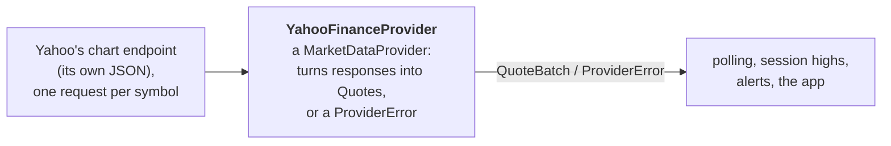

# Market-data providers

**Code:** `Sources/VettiraCore/Providers/`.

Vettira reads quotes from Yahoo Finance's chart endpoint: one of the unofficial JSON endpoints its
web pages use, which the [yfinance](https://github.com/ranaroussi/yfinance) project also reads. It
needs no key, no account and no cookie, and there's nothing to set up.

## Read this first

- **Unofficial and undocumented.** Yahoo has no public market-data API. This endpoint isn't
  published, documented or supported for use by other apps.
- **Not licensed or endorsed by Yahoo.** Vettira isn't affiliated with Yahoo, Yahoo hasn't
  approved this use, and nothing here gives you any right to Yahoo's data.
- **Yahoo's terms govern your use.** Yahoo's terms of service apply to its data and to how it's
  reached: read them at [legal.yahoo.com](https://legal.yahoo.com/us/en/yahoo/terms/otos/index.html).
  Among other things, they restrict collecting data by automated means, commercial use and
  high-volume use, each without Yahoo's permission, and Vettira has no permission from Yahoo.
  Whether your use follows them is between you and Yahoo, and you're responsible for it. Vettira
  is for personal, non-commercial use on your own Mac; don't redistribute the data.
- **It can break or be blocked without notice.** Yahoo can change the endpoint, limit how often
  it answers, or refuse requests from apps like Vettira, from your network or from your region,
  at any time. When it does, Vettira shows the error and has no quotes until it works again.
- **Possibly delayed.** A quote can lag the exchange, and this endpoint doesn't say by how much.
  Each quote carries its own time, so its age shows any delay and a stale quote can be kept from
  firing an alert.
- **Not consolidated.** A quote is Yahoo's view of the market, not the consolidated tape across
  every exchange.
- **Not tick-by-tick.** Vettira asks for quotes at an interval and sees the latest price at that
  moment, not every trade between.
- **Its high may be observed.** When Yahoo supplies the regular session's high, Vettira uses it as
  the session high. When it doesn't, the only high Vettira has is the highest price it saw while
  running, which it labels the "observed high"; it can be lower than the day's actual high.

## What Vettira sends, and keeps

One request per symbol in the watchlist, each time it updates:

| Request | What for |
|---|---|
| `GET https://query1.finance.yahoo.com/v8/finance/chart/<symbol>?range=1d&interval=1d` | The symbol's latest quote, in the chart's `meta` |

- **One at a time, at most one a second.** Requests go one after another, never in parallel,
  with at least a second between any two, so a watchlist of ten symbols takes about ten seconds
  to update.
- **An honest User-Agent:** `Vettira (https://github.com/nikpietanze/vettira)`, never a browser's.
- **Nothing about you** beyond what any web request carries, like your IP address: no key, no
  cookie, no account. Vettira keeps nothing from the responses but the quotes.
- It reads no web pages, follows no consent forms, and downloads no history.
- **Test Connection**, in Settings, is the one request you trigger yourself: one quote for the
  menu-bar symbol (SPY while the watchlist is empty), sent in turn with the updates' requests and
  at the same pace, never alongside one. It says what came back: the quote with its time and age;
  that it's stale (older than the staleness tolerance in regular hours); the last session's price
  while the market is closed; or the error below, each with its own message and what to do.

If Yahoo rate-limits a request (HTTP 429), refuses it (HTTP 403), redirects it to a consent page,
or is down, the update stops there, since the remaining symbols would fail the same way. A symbol
Yahoo doesn't know (HTTP 404, "No data found, symbol may be delisted"), or returns without a usable
price or time, is listed on its own, and the rest of the watchlist still updates.

From each response it reads the regular session's fields only, from `chart.result[0].meta`:

| Yahoo's field | Becomes |
|---|---|
| `regularMarketPrice` | the price |
| `regularMarketTime` | the quote's time (seconds since 1970) |
| `regularMarketDayHigh` | the session high, when present |
| `currentTradingPeriod.regular` | the session: regular when the quote's time falls in the day's regular period (its close included), closed otherwise, unknown without the period |

The endpoint declares no delay, so a quote has none (`providerDelay` is empty), and its age is
what shows how current it is. Outside the regular session the price, time and high are the last
regular session's, and an extended-hours price is never read.

## How a provider plugs in

Everything past the provider (polling, session highs, alerts, the app) depends on the
`MarketDataProvider` protocol and the `Quote` it returns, never on Yahoo, so a licensed or
streaming provider can be added later as one new type that conforms to the protocol.

A `MarketDataProvider` has:

| Member | What it does |
|---|---|
| `name` | The provider's name, shown as each quote's source: "Yahoo Finance (unofficial)" |
| `streams` | Whether it pushes quotes as they change; when it doesn't, Vettira polls. Yahoo's doesn't |
| `quotes(for:)` | The latest quotes for many symbols, in as few requests as the provider allows (Yahoo's: one per symbol, paced). Symbols it doesn't know come back in the batch's `unknownSymbols`, and symbols it returned without a usable price or time (a halted or newly listed symbol, say) in its `unusableSymbols`; the rest of the batch still comes. Only a response that can't be read at all fails the batch |
| `testConnection(symbol:)` | One quote for one symbol, for Test Connection in Settings: by default one `quotes(for:)` call, so it goes through the same requests and pacing as a poll, waits behind any poll's request in flight, and counts against the one-request-a-second limit. It returns the quote, or throws why there's none: the provider's error, `unknownSymbols` or `noUsableQuote` for the symbol, or `malformedResponse` when nothing came back for it |

Providers reach the network only through `HTTPClient`, so their tests answer with recorded
responses and never call the provider.

### A quote

| Field | What it is |
|---|---|
| `symbol` | The ticker, as the provider returned it |
| `price` | The last price |
| `timestamp` | When the provider says the price was set, not when Vettira received it; `age(at:)` is the time since |
| `source` | The provider's name |
| `sessionHigh` | The regular session's high, only when the provider supplies it as that; otherwise empty, and Vettira's own high is the observed high |
| `session` | Pre-market, regular, post-market, closed, or unknown, as the provider reports it |
| `providerDelay` | How far behind the exchange the provider says its data is, when it says |

### Errors

Each error says what happened and what you can do about it. None includes the provider's raw
response.

| Error | When | What to do |
|---|---|---|
| `rateLimited` | Too many requests in a short time (HTTP 429), with how long to wait when the provider says so in whole seconds (`Retry-After`, capped at a day; anything else is no wait given); the update stops there | Wait; if it keeps happening, lengthen the update interval |
| `blocked` | The provider refused the request (HTTP 403), or redirected it to a consent page | Try later; some networks and regions are blocked, and Vettira can't accept a consent page for you |
| `unknownSymbols` | The provider doesn't recognize these symbols | Check the spelling and use the provider's ticker |
| `noUsableQuote` | The provider returned these symbols with no usable price or quote time. In a batch they're listed in `unusableSymbols`; Test Connection throws it, and `unknownSymbols` for a symbol the provider doesn't know | The symbol may be halted or newly listed; check again later |
| `malformedResponse` | The response couldn't be read: not the expected JSON, or an unexpected status | Try later; if it persists, the provider may have changed its responses, so report it |
| `unavailable` | No network, or the provider had a server error (HTTP 5xx) | Check the connection; otherwise try later |

## The demo provider

`DemoProvider` makes up prices, so the app can be tried and checked without calling Yahoo. The
app uses it only in a Debug build launched with `--demo` ([the README](../README.md) and
[architecture.md](architecture.md#the-app) say how); a release build
always uses Yahoo's. Its name, "Demo (made-up prices)", is every quote's source, so the popover,
the dashboard and each notification say the prices aren't real.

Each symbol starts at its own base price, from 100 to 499 and the same on every run, and moves
one step per poll through a fixed path, in percent above the base: 0, 0.10, 0.20, 0.30, 0.15,
0.00, −0.15, −0.10, then it holds at −0.10. Its high, the observed one, is 0.30% above the base,
so with the default thresholds the sixth poll is 0.30% below it (an early warning), the seventh
0.45% (a stronger warning), and nothing alerts after that. Each quote is timestamped at the
monitor's clock, in the regular session, with no session high. The app moves the monitor's clock
into the regular session (`DemoProvider.regularHoursOffset`), to 30 minutes after the open of
the session the moment belongs to, so the demo alerts at any time of day. It polls at the update
interval in the settings, so at 10 seconds the early warning comes about a minute after launch.
Its Test Connection returns the symbol's quote at its current step without moving it on, so
testing doesn't change when the warnings come.
